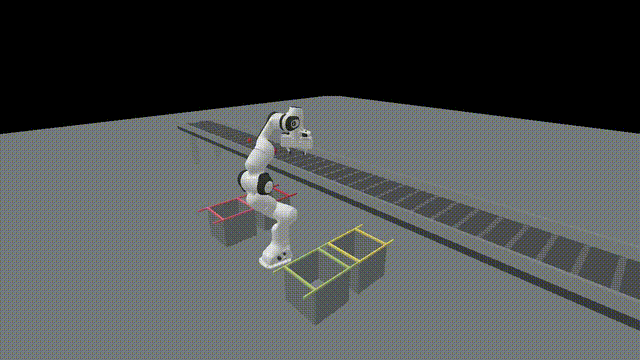

# Fruitsort

**动态传送带水果分拣**的具身智能研究项目：单 Franka Panda 从运动中的传送带上抓取苹果 / 草莓 / 香蕉 / 梨，
按类别放入料框。仓库包含可复现的 ManiSkill3 仿真、程序化水果资产、预测拦截基线、基准评测与论文笔记。



## 演示视频

- **连续作业（v1.53）**：`assets/videos/stream_demo_v153.gif`（稀疏，间距 3–4 m）/
  `assets/videos/stream_demo_v153_dense.gif`（密集，间距 0.6–1.2 m）
  完整 120 s 版：`data/fruitsort/eval/stream_geom_sparse_3m.mp4`（6/6）、
  `stream_geom_dense_1m.mp4`（12/14），同目录有 `.txt` 说明
- `data/fruitsort/eval/pure_policy_v015.mp4` —— **0.15 m/s，四类各一次，4/4**，1080p/40s，
  左上角叠加 kind / 带速 / 时间 / 相位

## 连续作业（v1.53，传送带不停 / 随机间隔 / 尺寸 ±15% / 多件在飞）

`FruitSortStream-v1`：单一下料流、间隔随机 `U(0.6–1.2)` 或 `U(2–4)` m、尺寸 `U(0.85,1.15)`、
按件统计 spawned / delivered / dropped / missed。**固定种子 60001–60005，5 局/档**：

| 模型 | 稀疏 3–4 m | 密集 0.6–1.2 m |
| --- | --- | --- |
| **`act-geom`（观测含抓取几何）** | **26/30 = 86.7%** | **51/69 = 73.9%** |
| `act-gnoisy`（无几何观测） | 18/30 = 60.0% | 36/67 = 53.7% |
| `act-wide-4c`（历史部署基线） | 10/30 = 33.3% | 14/68 = 20.6% |
| 规则专家（参考上限） | 5/6 = 83.3% | 10/14 = 76.9% |

单发（同一模型、`--fb 0.7 --grip-ema 0.7`）：**苹果 8/8、香蕉 7/8**。

关键改动：状态从 49 维扩到 **57 维**，末尾 4 维是 `(TCP − 目标水果)` 的 `dx, dy, dz, |d|`——
模型原本要从两个绝对坐标里自己相减才能判断"离果心还有 6 cm、该继续下沉"，回归头学不到。

```bash
# 训练
python scripts/train_act.py --data <repro-*> <noisy-*> <gnoisy-*> --geom --phase \
    --delta-actions --no-cvae --epochs 12 --batch 32 --stride 2 --lr 3e-4 \
    --descend-boost 3 --carry-boost 3 --out runs/act-geom

# 连续作业评测（另一档把 3.0/4.0 换成 0.6/1.2）
python scripts/stream_eval.py --ckpt runs/act-geom/ckpt.pt --fb 0.7 --grip-ema 0.7 \
    --belt 0.08 --seconds 120 --slots 1 --gap-min 3.0 --gap-max 4.0 --seed 60001
```

评测链路里的一个关键 bug 已修（v1.27）：缺类时 `fruit_actors[kind]` 指向场外 `z=-5` 的 ghost，
观测离开分布导致策略冻结；现在缺类会给"刚上料"的替身。详见 `docs/model-architecture.md` 6.26。

## 纯策略里程碑（v1.7，0.06–0.18 m/s 宽速域单一策略，无脚本执行器）

`runs/act-wide-4c` + `--fb 0.5 --grip-ema 0.6 --carry-latch --carry-max-step 0.02`：

| 带速 | 成功率 | 单件处理时间 |
| --- | --- | --- |
| 0.08 m/s | 28/32 = 87.5% | 4.2–6.7 s |
| **0.15 m/s** | **31/32 = 96.9%** | 5.2–6.4 s |
| 0.18 m/s | 苹果 5/5、草莓 4/5 | — |

另：把「料框前减速」交给策略学（`--carry-boost 3`，`act-wide-4c-v2`）后，
0.15 m/s 四类 **32/32 = 100%** 且不再需要人工搬运限速；但该配置在 0.08 退化到 71.9%，
故部署仍推荐上表（人工 2cm 限速）配置。

```bash
python scripts/eval_act_pure.py --ckpt runs/act-wide-4c/ckpt.pt \
  --instruction apple --episodes 8 --belt 0.15 --spawn-spacing 0.45 --control-freq 30 \
  --fb 0.5 --grip-ema 0.6 --carry-latch --carry-max-step 0.02
```

### 早前配置（v1.5，0.06–0.12 m/s 域随机化）

| 带速 | 成功率 | 单件处理时间 |
| --- | --- | --- |
| **0.08 m/s（标称）** | **27/32 = 84.4%**（苹果 8/8、草莓 7/8、香蕉 8/8、梨 4/8） | 2.7–3.9 s |
| 0.06 m/s | 苹果 5/5、草莓 4/5 | — |
| 0.12 m/s | 苹果 5/5、草莓 4/5 | — |
| 0.15 m/s（`act-015-4c`） | 23/40 = 57.5%（苹果 100%、香蕉 70%、梨 60%、草莓 0%） | <8 s |

抗扰（0.08 m/s）：横向偏移 ±12cm 苹果 3/5、草莓 3/5；侧向推力 1.5N 苹果 5/5、草莓 4/5。
对比：只在 0.08 训练的速度专用模型（`act-008-4c-v2`）在 0.06/0.12 上均为 **0/5**，
0.08 上 58/80 = 72.5%——**速度域随机化同时提升了成功率与速度泛化**。

```bash
python scripts/eval_act_pure.py --ckpt runs/act-008-4c-v2/ckpt.pt \
  --instruction apple --episodes 10 --belt 0.08 --spawn-spacing 0.35 \
  --control-freq 30 --fb 0.5 --grip-ema 0.6 --carry-latch
```
详见 [`docs/model-architecture.md`](docs/model-architecture.md) 6.6 与
[`docs/benchmark.md`](docs/benchmark.md)「低速纯策略协议」。

## 验收结果（v1.0.0，四类同场，平行夹爪）

| 带速 | 成功率 | 单件节拍 |
| --- | --- | --- |
| 0.08 m/s | 95–97.5% | 2.8–4.0 s |
| **0.25 m/s（验收档）** | **22/24 = 91.7%** | **3.94 s（P90 5.82 s）** |
| 0.30 m/s | 83.3%（苹果/草莓 100%） | 3.8 s |

- 指令选择：**100%**（四类，96/96）
- 模型：0.41M 参数，GPU 1.9 ms / CPU 单线程 6.1 ms
- 0.30 m/s 的香蕉/梨受顶抓物理限制；吸盘原型可达 100% 但**不纳入本项目**

## 早期结果（v0.2.0）

| 场景 | 成功率 | 95% CI | 平均耗时 |
| --- | --- | --- | --- |
| 苹果 + 草莓（10 episodes） | **100%** (10/10) | 72.2–100% | 18.5 s |
| 苹果单类（6） | 100% (6/6) | 61.0–100% | 10.9 s |
| 草莓单类（6） | 100% (6/6) | 61.0–100% | 10.6 s |
| 香蕉单类（6） | 33.3% (2/6) | 9.7–70.0% | 36.8 s |
| 梨单类（6） | 50.0% (3/6) | 18.8–81.2% | 36.4 s |

> 基线是**脚本专家 + 仿真真值位姿**（性能上界与示教源）。香蕉/梨的滑落是 v0.3 的主要改进点。

## 快速开始

```bash
source scripts/env.sh maniskill3    # ROS 2 Humble + conda 环境
make doctor                          # 环境体检 → docs/env-report.md

# 跑一段演示并录像
python scripts/demo.py --kinds apple strawberry --belt-speed 0.06 \
    --video data/eval/demo.mp4

# 基准评测
python scripts/benchmark.py --scenario pair --episodes 10 --belt-speed 0.06
python scripts/benchmark.py --scenario per_class --episodes 6
```

## 系统结构

```
感知（v0.3: RGB-D） → 目标选择（TTC + 可达性） → 拦截点预测（恒速/卡尔曼）
        → 抓取状态机（TRACK → DESCEND → CLOSE → CARRY → LOWER → RELEASE）
        → 20 Hz 绝对位姿控制（Franka Panda）
```

| 路径 | 内容 |
| --- | --- |
| `src/fruitsort/sim/` | 仿真环境、传送带、料框、程序化水果资产 |
| `src/fruitsort/policies/` | 脚本专家（预测拦截 + 抓放状态机） |
| `src/fruitsort/eval.py` | Wilson 置信区间、episode 汇总 |
| `scripts/benchmark.py` | 官方评测入口（per_class / pair / all4） |
| `scripts/demo.py` | 运行 + 录像 |
| `assets/meshes/` | 程序化生成的水果 GLB（可重建） |
| `docs/` | 任务定义、方案、资产、基准、文献、ManiSkill3 API |
| `notes/papers/` | 论文精读笔记（12 篇 + 补充） |

## 多视角指令条件策略（v0.5）

- **0.41M 参数**，2 层 Transformer + 共享 CNN
- 输入：overhead + 腕部两路 RGB（各 96×96，4 帧历史）+ 49 维状态 + 水果指令
- 输出：8 步动作块（世界目标位姿 + 夹爪）、未来 3 步状态、4 类水果选择 logits
- **实测**：GPU 1.9 ms / CPU 单线程 6.1 ms；指令选择 100%（苹果/草莓/香蕉）
- **纯视觉**：苹果 5/5、草莓 5/5（10.6 / 17.0 s 每件）；分层执行 10/10

```bash
python scripts/train_vision_policy.py --data data/datasets/instr-apple \
    data/datasets/instr-strawberry --out runs/vpolicy --epochs 40
python scripts/bench_latency.py --ckpt runs/vpolicy/ckpt.pt
python scripts/eval_hybrid.py --ckpt runs/vpolicy/ckpt.pt --episodes 10
```

详见 [docs/model-architecture.md](docs/model-architecture.md)。

## 模仿学习（v0.4）

```bash
# 采集 40 条专家示教（成功才保存）
python scripts/record_demos.py --kinds apple strawberry --episodes 40
# 训练 BC（5 帧历史 + 动作分块）
python scripts/train_bc.py --data data/datasets/fruitsort-XXXX --out runs/bc --epochs 80
# 闭环评测（seed 100+，与训练不重叠）
python scripts/eval_bc.py --ckpt runs/bc/ckpt.pt --kinds apple strawberry --episodes 10
```

当前结果：专家 100%，BC 10%（1/10）。离线拟合很好但闭环漂移，说明需要 DAgger / 时序策略，
详见 [docs/learning.md](docs/learning.md)。

## 视觉感知（v0.3，实验性）

```bash
python scripts/calibrate_camera.py          # 标定 overhead 相机（单应）
python scripts/benchmark.py --scenario pair --perception vision
```

位置估计：苹果 4 mm、草莓 8 mm、香蕉 21 mm、梨 15 mm。闭环控制尚未跑通（遮挡/分类歧义），
详见 [docs/perception.md](docs/perception.md)；默认评测仍用 oracle 位姿。

## 文档

- [解决方案与架构](docs/solution-architecture.md) — 分层、选型、论文→模块映射
- [任务定义](docs/task-spec.md) — 成功判据、动作空间、评测协议
- [仿真资产](docs/sim-assets.md) — 水果尺寸/质量/摩擦、机器人、传送带
- [基准结果](docs/benchmark.md) — 协议、数字、失败模式
- [研究路线图](docs/roadmap.md) / [决策记录](docs/decisions.md)
- [动态抓取文献综述](docs/literature-dynamic-grasping.md)
- [ManiSkill3 自定义任务 API](docs/maniskill3-api.md)
- [环境与约定](AGENTS.md)

## 版本管理

- 语义化版本 + git tag（`v0.1.0` / `v0.2.0` …），每个版本对应一个 GitHub Release。
- 详细变更见 [CHANGELOG.md](CHANGELOG.md)；Release 描述包含「做了什么 / 怎么验证 / 已知问题 / 下一步」。

## 环境

RTX 5090 32GB（sm_120，需 CUDA 12.8+ 的 torch）· Ubuntu 22.04 · ROS 2 Humble ·
conda 环境 `maniskill3`（ManiSkill3 3.0.1 / SAPIEN 3.0.3）。
