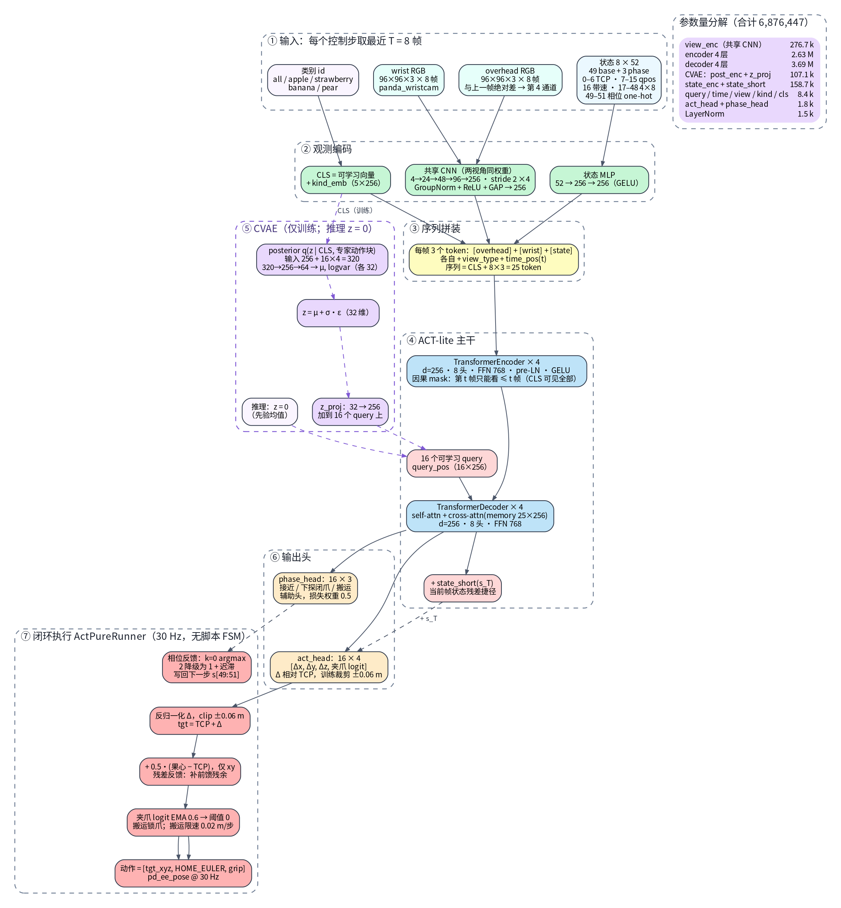
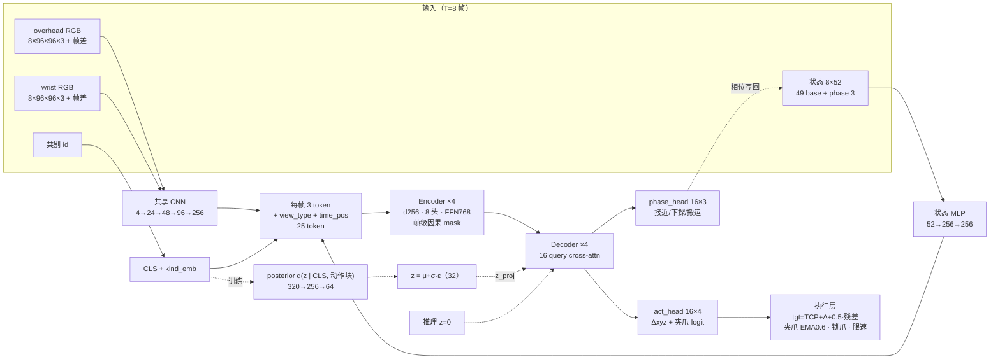
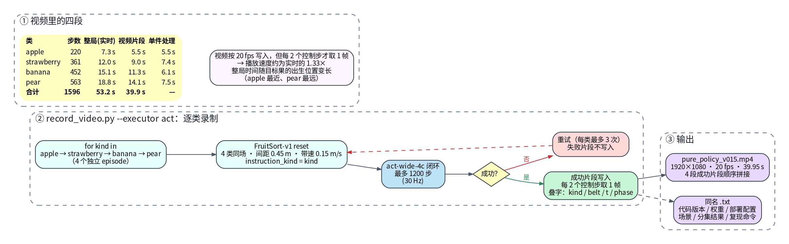

# `act-wide-4c`（v1.7）模型架构 · 测试结果 · `pure_policy_v015.mp4` 视频说明

> 版本：**v1.7.0**（视频录制代码版本 `6184074`，2026-11-19）
> 权重：`runs/act-wide-4c/ckpt.pt`（**6,876,447** 参数，best val **0.4808**，增量动作）
> 视频：`data/eval/pure_policy_v015.mp4` + 同名 `.txt`
> 图源：`docs/architecture-act-wide-4c-model.dot` / `docs/architecture-act-wide-4c-video.dot`

**一句话**：ACT-lite 动作分块 Transformer + **CVAE 隐变量**，输入 8 帧双视角 RGB 与
**52 维状态**（49 维本体/物体 + 3 维相位），输出 16 步增量动作块；在 **0.06–0.18 m/s**
宽速域示教上训练，0.15 m/s 四类单发 **31/32 = 96.9%**。

---

## 0. 速览

| 项 | 值 |
| --- | --- |
| 模型 | `act-wide-4c`（ACT-lite + CVAE） |
| 参数量 | **6,876,447** |
| 观测 | 状态 **52 维** × 8 帧 + overhead 96² × 8 + wrist 96² × 8 |
| 动作 | 16 步动作块 × 4 维（Δxyz + 夹爪 logit），只执行第 0 步 |
| 训练数据 | 167 段示教 / **41,074** 窗口，带速 **0.06–0.18 m/s** |
| 训练 | 60 epoch，batch 64，lr 1e-4，best val **0.4808**（epoch 5） |
| 单发结果 | 0.08 m/s **28/32 = 87.5%**；0.15 m/s **31/32 = 96.9%** |
| 视频 | 0.15 m/s，四类 **4/4**，1920×1080，39.95 s |

---

## 1. 模型架构图





### 1.1 一次前向的完整张量流

以 batch `B`、历史 `T=8`、图像 `96×96` 为例：

| 阶段 | 张量形状 | 说明 |
| --- | --- | --- |
| overhead 输入 | `(B, 8, 3, 96, 96)` | 8 帧 RGB |
| 帧差 | `(B, 8, 1, 96, 96)` | 与上一帧绝对差 |
| CNN 输入 | `(B×8, 4, 96, 96)` | RGB + 帧差 |
| CNN 输出 | `(B×8, 256)` → `(B, 8, 256)` | 每帧每视角 256 维 |
| 状态输入 | `(B, 8, 52)` | 每帧 52 维 |
| 状态编码 | `(B, 8, 256)` | 两层 MLP |
| 每帧 token | `(B, 8, 3, 256)` | overhead / wrist / state |
| 展平序列 | `(B, 24, 256)` | 8 帧 × 3 token |
| 加 CLS | `(B, 25, 256)` | CLS + 24 |
| 编码器输出 | `(B, 25, 256)` | memory |
| query | `(B, 16, 256)` | 16 个可学习 query |
| 解码器输出 | `(B, 16, 256)` | 每个 query 一个时间步 |
| 动作头 | `(B, 16, 4)` | Δxyz + 夹爪 logit |
| 相位头 | `(B, 16, 3)` | 接近 / 下探 / 搬运 |

CVAE 分支（仅训练）：

| 阶段 | 形状 |
| --- | --- |
| posterior 输入 | `(B, 256 + 16×4) = (B, 320)` |
| 隐层 | `(B, 256)` |
| μ / logvar | `(B, 32)` / `(B, 32)` |
| z | `(B, 32)` |
| z_proj | `(B, 256)`，广播加到 16 个 query |

### 1.2 因果掩码长什么样

25 个 token 的注意力掩码（✓ 可看，✗ 屏蔽）：

```text
          key:  CLS  t0  t1  t2 ... t7
query CLS        ✓   ✓   ✓   ✓      ✓
query t0         ✗   ✓   ✗   ✗      ✗
query t1         ✗   ✓   ✓   ✗      ✗
query t2         ✗   ✓   ✓   ✓      ✗
...              ✗   ✓   ✓   ✓      ✓
query t7         ✗   ✓   ✓   ✓      ✓
```

两个关键点：

1. **帧内全可见、帧间因果**：第 t 帧的 3 个 token 可以互相看，但不能看 t+1；
2. **CLS 是单向的**：CLS 能看全部历史，但其他 token 看不到 CLS。
   否则第 t 帧就能通过 CLS 间接看到未来，因果掩码就失效了。

### 1.3 为什么这样切 token

- 每个视角单独一个 token，Transformer 可以自己学“看哪一路、看哪一帧”；
- 状态也单独一个 token，不和图像特征拼接，避免 256 维里被图像淹没；
- `view_type` 告诉模型这是 overhead / wrist / state，`time_pos` 告诉它是第几帧；
- CLS 只做全局汇总和类别条件，不参与时序因果链。

---

## 2. 输入

### 2.1 图像

| 输入 | 形状 | 说明 |
| --- | --- | --- |
| overhead RGB | `8 × 96 × 96 × 3` | 俯视全局，负责类别/外观/位置 |
| wrist RGB | `8 × 96 × 96 × 3` | 腕部近景，负责夹爪与果实相对关系 |

每帧额外计算与上一帧的绝对差，作为第 4 通道：

```text
RGB 3 通道 + |I_t − I_{t−1}| = 4 通道
```

第一帧差为 0。这是零成本运动线索，传送带上的动态抓取依赖它。

### 2.2 状态 52 维

```text
52 = 49 base + 3 phase
```

| 下标 | 维度 | 内容 |
| --- | --- | --- |
| `0–6` | 7 | TCP 位姿：xyz + 四元数 |
| `7–15` | 9 | qpos：7 关节 + 2 指 |
| `16` | 1 | 传送带线速度 |
| `17–48` | 32 | 4 类 ×［pos 3, vel 3, active, held］ |
| `49–51` | 3 | 相位 one-hot：接近 / 下探闭爪 / 搬运 |

- 相位由策略自己的 `phase_head` 预测后写回，不是脚本 FSM；
- 这一版**没有**队列密度，也没有显式抓取几何；几何信息要靠 49 维里的绝对坐标自己学。

> ⚠️ 物体位置/速度来自仿真真值（privileged state）；图像提供外观上下文。
> 这是 oracle 状态下的策略上限。

---

## 3. 观测编码与 token 序列

### 3.1 共享 CNN

两路视角共享同一套卷积权重，逐帧独立编码：

```text
Conv(4→24,  k5, s2, p2) → GroupNorm → ReLU
Conv(24→48, k3, s2, p1) → GroupNorm → ReLU
Conv(48→96, k3, s2, p1) → GroupNorm → ReLU
Conv(96→256,k3, s2, p1) → GroupNorm → ReLU
AdaptiveAvgPool → 256
```

- 96×96 经四次 stride 2 变 6×6，再全局平均池化；
- 用 GroupNorm 而非 BatchNorm：小数据上 running stats 偏移会让部署特征漂移；
- 共享权重减少参数，并让两个视角的特征空间一致。

### 3.2 状态编码

```text
state 52 → Linear(52,256) → GELU → Linear(256,256) → 256
```

另有 `state_short`：

```text
state_short(s_T): 52 → 256 → 256
```

把**当前帧**状态直接残差加到解码器输出，保证精确几何不被 96² 图像稀释。

### 3.3 25 个 token

每帧 3 个 token：

```text
[t_overhead, t_wrist, t_state]
```

加 `view_type`（3×256）、`time_pos`（8×256）、`CLS`（1×256）+ `kind_emb`（5×256）：

```text
[CLS, t0_oh, t0_wr, t0_st, ..., t7_oh, t7_wr, t7_st]
长度 = 1 + 8×3 = 25
```

**因果掩码**：

- 第 t 帧只能看 ≤ t 帧（含同帧其他视角）；
- CLS 可见全部；
- 其他 token 看不到 CLS；
- 训练与流式推理一致，不泄漏未来。

---

## 4. Transformer 主干

| 项 | 值 |
| --- | --- |
| 编码器 | 4 层，d=256，8 头，FFN 768，pre-LN，GELU |
| 解码器 | 4 层，self-attn + cross-attn 到 25 个 memory token |
| dropout | 0.15 |
| 动作块 | 16 个可学习 query |
| 输出 | `16×4` 动作 + `16×3` 相位 |

每个 query 负责一个未来时间步。解码器输出再加当前帧状态残差，然后分别送两个头。

---

## 5. CVAE：这一版的核心部件

### 5.1 为什么需要它

示教覆盖 **0.06–0.18 m/s** 的宽速域。同一观测下，专家可能：

- 提前下探、快速抓；
- 晚一点下探、慢速跟随；
- 以不同轨迹搬运。

如果只用确定性回归头，这些多模态轨迹会被平均成“中间解”（悬停不降、闭爪太晚）。
CVAE 用一个 32 维隐变量 `z` 表示“这一条示教的风格”，把多模态从回归头里分离出去。

### 5.2 训练路径

```text
posterior 输入 = [CLS (256), 专家动作块 (16×4 = 64)] = 320
320 → 256 → 64  →  μ (32), logvar (32)
z = μ + σ·ε
z_proj: 32 → 256，加到 16 个 query 上
```

- posterior 只看**训练时**的专家动作块；
- 损失里加 `KL(q(z) || N(0,1))`，权重 **1.0**；
- 这样 `z` 学会编码“专家这一次的走法”。

### 5.3 推理路径

```text
z = 0（先验均值）
```

不使用 posterior，也不采样。部署完全确定性：

- 同一观测 → 同一动作；
- `z=0` 相当于取“平均风格”，避免随机性导致闭环抖动。

### 5.4 参数量

```text
post_enc: 98,624
z_proj:    8,448
合计:    107,072
```

---

## 6. 动作表示与输出头

### 6.1 增量动作

```text
action[k] = clip(target(t+k) − TCP(t+k), ±0.06)
```

- 每个 chunk 步相对**未来第 k 步的 TCP**；
- 到位置后位移自然衰减到 0，闭环有负反馈；
- 夹爪：原始动作 < 0 → 1（闭合），否则 0。

### 6.2 输出头

| 头 | 形状 | 含义 |
| --- | --- | --- |
| `act_head` | `16 × 4` | `[Δx, Δy, Δz, 夹爪 logit]` |
| `phase_head` | `16 × 3` | 接近 / 下探闭爪 / 搬运 |

推理只执行第 0 步，下一步重新观测、重新规划（`chunk_exec=1`）。

---

## 7. 参数量分解

| 模块 | 参数 |
| --- | --- |
| `view_enc`（共享 CNN） | 276,696 |
| encoder ×4 | 2,633,728 |
| decoder ×4 | 3,688,448 |
| CVAE（`post_enc` + `z_proj`） | 107,072 |
| `state_enc` + `state_short` | 158,720 |
| query / time / view / kind / cls | 8,448 |
| `act_head` + `phase_head` | 1,799 |
| LayerNorm | 1,536 |
| **合计** | **6,876,447** |

---

## 8. 训练

### 8.1 数据

| 类 | 成功示教段数 | 采集尝试 |
| --- | --- | --- |
| apple | 50 | 50 |
| strawberry | 50 | 50 |
| banana | 39 | 50 |
| pear | 28 | 50 |
| **合计** | **167** | 200 |

- 带速：**0.06–0.18 m/s** 域随机化；
- 控制频率：20 Hz；
- 只保存成功片段；
- 窗口：**41,074**（`hist=8`、`chunk=16`、`stride=2`，含下探窗 ×3 过采样）。

### 8.2 标签

| 项 | 做法 |
| --- | --- |
| Δ 动作 | 相对未来 TCP，裁剪 ±0.06 m |
| 夹爪 | 二值化，BCE 用 `pos_weight` 平衡 |
| 相位 | 目标 xy 进料框 ±0.20 m → 2（锁存）；`\|Δz\|<0.06` → 1；否则 0 |
| 过采样 | 下探/闭爪窗 ×3 |
| 延迟增强 | 10% 概率把最后一帧替换成上一帧 |
| 图像增强 | 亮度/对比度抖动 |
| 验证集 | 按 episode 分层留出 15% |

### 8.3 损失

```text
L = MSE(Δxyz)
  + 2.0 · BCE(夹爪)
  + 1.0 · KL(q(z) || N(0,1))
  + 0.5 · CE(相位)
```

### 8.4 优化

| 项 | 值 |
| --- | --- |
| 优化器 | AdamW |
| lr | 1e-4 |
| weight decay | 1e-2 |
| 调度 | cosine |
| batch | 64 |
| epoch | 60 |
| 单 epoch | 约 30 s |
| 总时长 | 约 **30 min**（单卡 5090） |

| epoch | train | val |
| --- | --- | --- |
| 0 | 0.6289 | 0.7501 |
| 1 | 0.2143 | 0.6083 |
| 2 | 0.1518 | 0.5680 |
| 3 | 0.1269 | 0.5216 |
| 4 | 0.1101 | 0.5132 |
| **5** | 0.0987 | **0.4808** |
| 10 | 0.0670 | 0.5406 |
| 20 | 0.0424 | 0.5992 |
| 40 | 0.0183 | 0.6914 |
| 59 | 0.0107 | 0.7108 |

第 5 轮后严重过拟合；部署取 best-val 权重。

> 这个 val 包含 KL、夹爪 BCE 与宽速域动作方差，绝对值不适合和其他任务直接比较；
> 它只用于本模型内的 checkpoint 选择。

---

## 9. 闭环执行

### 9.1 每个控制步

```text
1. 拼观测：52 维状态 + 8 帧双视角图像
2. 前向（z=0）：16×4 动作块 + 16×3 相位
3. 取第 0 步：Δ, grip_logit
4. tgt = TCP + clip(Δ, ±0.06)
5. if 未抓住: tgt += 0.5 · (果心 − TCP)   # 仅 xy
6. grip_logit = EMA(0.6)；> 0 → 闭合
7. 若已抓住：锁爪；搬运限速 0.02 m/步
8. 相位反馈：argmax(phase[0]) → 下一步 s[49:51]
9. 下发 [tgt_xyz, HOME_EULER, grip] → pd_ee_pose
```

### 9.2 安全/恢复层

| 机制 | 作用 |
| --- | --- |
| `tgt[2] ≥ 果心 z − 0.02` | 未抓住时不允许下穿果心 |
| TCP 落后果心 >8 cm 且相位=1 | 退回接近相位，重新对准 |
| 闭爪 12 步仍未抓住 | 自动开爪、相位复位 |
| 单步位移限幅 | 接近 0.06 m、搬运 0.02 m |
| 搬运锁爪 | 连续 3 步想开爪才真正松开 |

抓取判定：手指接触，或（距离 <4.5 cm 且上一步闭爪）。

**没有任务级脚本 FSM**：抓谁、何时抓、放哪由策略输出 + 上述迟滞/安全层决定。

---

## 10. 测试结果

### 10.1 单发批量（每类 8 局）

| 带速 | apple | strawberry | banana | pear | 合计 |
| --- | --- | --- | --- | --- | --- |
| 0.08 m/s | 8/8 | 8/8 | 8/8 | 4/8 | **28/32 = 87.5%** |
| **0.15 m/s** | 8/8 | 8/8 | 8/8 | 7/8 | **31/32 = 96.9%** |
| 0.18 m/s | 5/5 | 4/5 | — | — | **9/10** |

- 0.08 的短板是梨（4/8）：抓取浅、易滑脱；
- 0.15 是这一版的甜点档：四类全部 ≥7/8；
- 0.18 只跑了苹果/草莓，不能外推四类。

单件处理时间：

| 带速 | 单件处理 |
| --- | --- |
| 0.08 m/s | 4.2–6.7 s |
| 0.15 m/s | 5.2–6.4 s |

### 10.2 视频单局

`pure_policy_v015.mp4`：0.15 m/s，四类各一次，**4/4**。
这是**单次成功录像**，不是统计结果；统计请用 10.1 的 31/32。

---

## 11. `pure_policy_v015.mp4` 视频说明



### 11.1 这段视频是什么

- 纯策略闭环（无脚本执行器、无任务 FSM）；
- 传送带 **0.15 m/s**，平行夹爪；
- 四类同场，但**每个类单独一个 episode**，只把该类设为指令目标；
- 成功片段顺序拼接；失败尝试不写入；
- 画面左上角叠加：`kind / belt / t / phase`。

### 11.2 录制流程

```text
for kind in [apple, strawberry, banana, pear]:   # 4 个独立 episode
    重置 FruitSort-v1（4 类同场，间距 0.45 m，带速 0.15 m/s）
    instruction_kind = kind
    跑 act-wide-4c 闭环，最多 1200 步（30 Hz）
    成功 → 写帧；失败 → 重试（每类最多 3 次）
成功片段顺序拼接 → mp4
```

### 11.3 每一段的数据

| 类 | 整局步数 | 整局（实时） | 视频片段 | 单件处理 |
| --- | --- | --- | --- | --- |
| apple | 220 | 7.3 s | 5.5 s | **5.5 s** |
| strawberry | 361 | 12.0 s | 9.0 s | **7.4 s** |
| banana | 452 | 15.1 s | 11.3 s | **6.1 s** |
| pear | 563 | 18.8 s | 14.1 s | **7.5 s** |
| **合计** | **1596** | **53.2 s** | **39.9 s** | — |

- **单件处理时间** = 目标进入抓取区 → 入框，不含传送带运送；
- **整局时间** 随目标果的出生位置变长：apple 最近、pear 最远，所以 pear 整局 18.8 s，
  但真正操作只用了 7.5 s；
- 视频是**单次运行**：批量统计的单件处理为 5.2–6.4 s，单次运行会落在更宽的范围
  （本视频 5.5–7.5 s），两者不矛盾；
- 视频文件 1920×1080、20 fps、39.95 s；
- 录制时每 2 个控制步取 1 帧（30 Hz → 15 个不同帧/秒），再按 20 fps 写入，
  因此**播放速度约为实时的 1.33×**。

### 11.4 部署配置

| 参数 | 值 |
| --- | --- |
| 权重 | `runs/act-wide-4c/ckpt.pt` |
| 残差反馈 | `fb=0.5`，仅 xy |
| 夹爪去抖 | `grip_ema=0.6` |
| 搬运锁爪 | `carry_latch=True` |
| 搬运限速 | `carry_max_step=0.02` |
| 控制频率 | 30 Hz |
| 机器人 | `panda_wristcam` |

### 11.5 复现命令

```bash
python scripts/record_video.py --executor act \
  --ckpt runs/act-wide-4c/ckpt.pt --classes apple strawberry banana pear --belt 0.15 \
  --spawn-spacing 0.45 --control-freq 30 \
  --fb 0.5 --grip-ema 0.6 --carry-latch --carry-max-step 0.02 \
  --episodes 4 --retries 3 --out data/eval/pure_policy_v015.mp4
```

---

## 12. 边界与注意事项

1. **oracle 状态**：水果位置/速度来自仿真真值，图像只提供外观。
2. **单发场景**：这一版没有连续流/多件在飞的目标选择；视频是逐类单件 episode 的拼接。
3. **视频是单次成功录像**：4/4 不代表统计成功率；0.15 的批量结果是 31/32。
4. **梨在 0.08 仍是 4/8**：抓取浅、易滑脱；0.15 反而 7/8。
5. **CVAE 推理取 z=0**：部署确定性，但也意味着只取“平均风格”，不会探索其他模态。
6. **0.18 只覆盖苹果/草莓**，香蕉/梨没有该档数据。

---

## 13. 相关文件

| 文件 | 内容 |
| --- | --- |
| `runs/act-wide-4c/ckpt.pt` | 权重 |
| `runs/act-wide-4c/metrics.json` | 训练曲线与超参 |
| `data/eval/pure_policy_v015.mp4` | 演示视频 |
| `data/eval/pure_policy_v015.txt` | 自动生成的视频说明 |
| `docs/architecture-act-wide-4c-model.png` | 模型架构图 |
| `docs/architecture-act-wide-4c-video.png` | 录像流程与分段 |
| `scripts/record_video.py` | 录像脚本（成功才写帧、失败重试） |
