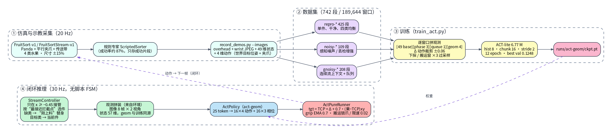
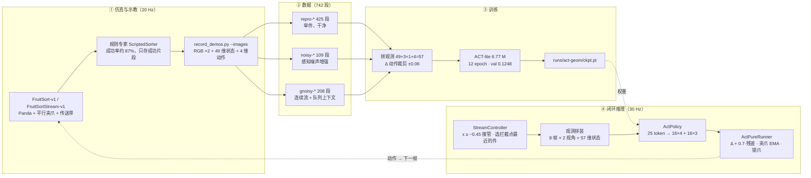
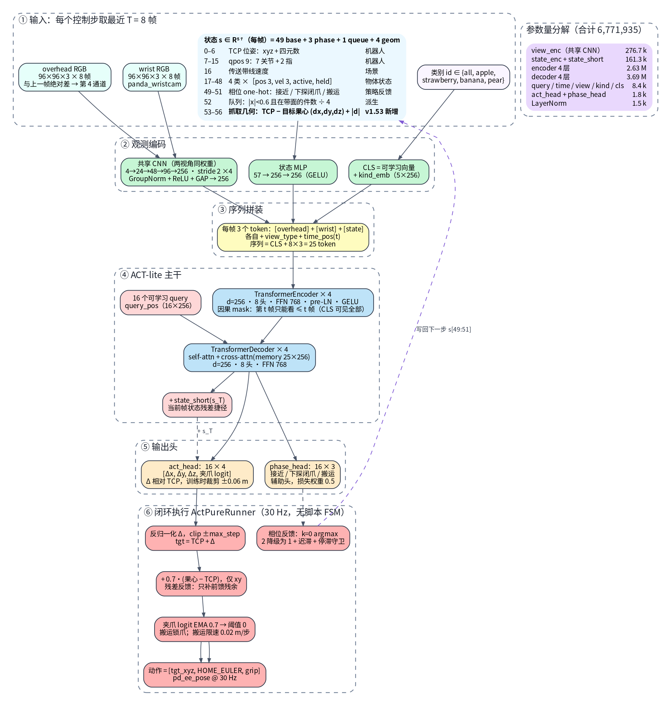

# v1.53.0 模型架构详解：ACT-lite + 抓取几何（`act-geom`）

> 版本：**v1.53.0**（tag `v1.53.0`，commit `5e4d09d`，2026-11-27）
> 权重：`runs/act-geom/ckpt.pt`（6,771,935 参数）
> 代码：`src/fruitsort/models/act_policy.py` · `src/fruitsort/policies/act_runner.py` ·
> `scripts/train_act.py` · `scripts/stream_eval.py`
> 图源：`docs/architecture-v1.53-model.dot` / `docs/architecture-v1.53-loop.dot`（Graphviz）

**一句话**：模型输入是「两路 96² RGB 历史 + 57 维状态」，其中状态末尾 4 维是
**TCP 相对目标果心的几何量**；输出 16 步动作块。连续作业 **86.7% / 73.9%**，
单发 apple **8/8**、banana **7/8**。

## 0. 速览

| 项 | 值 |
| --- | --- |
| 模型 | ACT-lite（编码器-解码器 Transformer + 动作分块） |
| 参数量 | **6,771,935**（6.77 M） |
| 观测 | 状态 **57 维** × 8 帧 + overhead 96² × 8 + wrist 96² × 8 |
| 动作 | 16 步动作块 × 4 维（Δxyz + 夹爪 logit），每步只执行第 0 步 |
| 训练 | 742 段示教 / 189,644 窗口，12 epoch，best val **0.1248** |
| 连续作业 | 稀疏 3–4 m **26/30 = 86.7%**；密集 0.6–1.2 m **51/69 = 73.9%** |
| 单发 | apple **8/8**、banana **7/8**（两次复测一致） |
| 核心设计 | `geom = (TCP − 目标水果) 的 dx, dy, dz, \|d\|`，训练/推理同源 |

---

## 1. 端到端：数据 → 训练 → 闭环





---

## 2. 模型结构



### 2.1 输入

每个控制步取最近 **T = 8 帧**：

| 输入 | 形状 | 说明 |
| --- | --- | --- |
| overhead RGB | `8 × 96 × 96 × 3` | 俯视全局，提供类别/外观/队列位置 |
| wrist RGB | `8 × 96 × 96 × 3` | 腕部近景，提供夹爪与果实的相对外观 |
| 状态 | `8 × 57` | 本体 + 物体 + 相位 + 队列 + **抓取几何** |
| 类别 id | 标量 | `all / apple / strawberry / banana / pear` |

图像第 4 通道是**相邻帧绝对差**（`|I_t − I_{t−1}|`），零成本运动线索；第一帧差为 0。

### 2.2 状态向量：57 维逐位布局

| 下标 | 维度 | 内容 | 来源 |
| --- | --- | --- | --- |
| `0–6` | 7 | TCP 位姿：xyz + 四元数 | 机器人 |
| `7–15` | 9 | qpos：7 关节 + 2 指 | 机器人 |
| `16` | 1 | 传送带线速度 | 场景 |
| `17–48` | 32 | 4 类 ×［pos 3, vel 3, active, held］ | 物体状态 |
| `49–51` | 3 | 相位 one-hot：接近 / 下探闭爪 / 搬运 | 策略反馈 |
| `52` | 1 | 队列：`\|x\|<0.6` 且在带面的件数 ÷ 4 | 派生 |
| `53–56` | 4 | **geom：TCP − 目标果心 (dx,dy,dz) + \|d\|** | **v1.53 新增** |

其中 `geom` 的严格定义（训练与推理同一份代码路径）：

```python
d = tcp_xyz - fruit_xyz          # 目标类水果，基座系
geom = [d.x, d.y, d.z, ||d||]    # 4 维，米
```

> ⚠️ v1.53 的物体位置/速度来自**仿真真值**（privileged state），图像只提供外观与类别上下文。
> 57 维里有 37 维直接/间接来自真值，因此 86.7%/73.9% 是 **oracle 状态下的策略上限**，
> 不是纯视觉部署结果（纯感知见 `docs/privileged-info-audit.md`）。

### 2.3 编码与前向形状

```text
overhead (B,8,3,96,96) ─┐
                        ├─ 帧差 → (B*8,4,96,96) → 共享 CNN → (B,8,256)
wrist    (B,8,3,96,96) ─┘        （两视角共享同一套卷积权重）

state    (B,8,57) ──────────────→ MLP 57→256→256 → (B,8,256)

每帧 3 token 拼接 → (B,8,3,256) → (B,24,256)
加 CLS（含 kind_emb）           → (B,25,256)
```

- **共享 CNN**：`Conv 4→24→48→96→256`，stride 2 ×4，GroupNorm + ReLU + 全局平均池化。
  用 GroupNorm 替代 BatchNorm，是为了消除小数据上 running stats 与 batch stats 的偏移
  （训练/评测行为一致，代码里由 `bn_to_groupnorm` 完成）。
- **状态 MLP**：`57→256→256`；另有 `state_short` 把**当前帧**状态直接残差到解码器输出，
  保证精确几何不被 96² 图像的低分辨率稀释。

### 2.4 Transformer 主干

| 组件 | 配置 |
| --- | --- |
| 序列长度 | `1 + 8×3 = 25`（CLS + 8 帧 × 3 token） |
| d_model | 256 |
| 注意力头 | 8（每头 32 维） |
| 编码器 | 4 层，FFN 768，pre-LN，GELU |
| 解码器 | 4 层，self-attn + cross-attn 到 25 个 memory token |
| 位置编码 | 可学习 `time_pos(8×256)` + `view_type(3×256)` |
| 因果掩码 | 第 t 帧的 token 只能看 ≤ t 帧；CLS 可见全部 |

动作分块：**16 个可学习 query**，每个 query 负责一个未来时间步；解码器逐步细化，
等价于“从同一段历史里展开一整条 16 步轨迹”。推理时只执行第 0 步，下一步重新观测、重新规划
（`chunk_exec = 1`）。

### 2.5 输出头

| 头 | 形状 | 含义 |
| --- | --- | --- |
| `act_head` | `16 × 4` | `[Δx, Δy, Δz, 夹爪 logit]`，Δ 相对 TCP，训练标签裁剪 ±0.06 m |
| `phase_head` | `16 × 3` | 接近 / 下探闭爪 / 搬运（辅助头，权重 0.5） |

夹爪：logit > 0 表示闭合。相位头不是脚本 FSM：推理时取第 0 步 argmax 写回下一步状态的
`49–51` 维，让策略自己携带“我在哪一段”的记忆。

### 2.6 参数量分解

| 模块 | 参数 |
| --- | --- |
| `view_enc`（共享 CNN） | 276,696 |
| `state_enc` + `state_short` | 161,280 |
| encoder ×4 | 2,633,728 |
| decoder ×4 | 3,688,448 |
| query / time / view / kind / cls | 8,448 |
| `act_head` + `phase_head` | 1,799 |
| LayerNorm | 1,536 |
| **合计** | **6,771,935** |

---

## 3. 为什么 4 维几何有效

如果只给 49 维状态，模型要判断“离果心还有 6 cm、该继续下沉”，必须自己完成：

```text
Δ = TCP 绝对坐标 − 水果绝对坐标
```

两个绝对坐标都是米级大数，而真正决定动作的是**它们的小差值**。回归头在 MSE 下更容易
拟合绝对量级的缓慢变化，学不到这个减法；表现就是队列里常见的两种失败：

- x 已经对齐，但 z 不下降（悬停）；
- 离果心还很高就闭爪（空中闭爪，夹空气）。

把 `Δ` 显式算好喂进去后，网络只需要学“给定 6 cm 偏差 → 往下走 6 cm”，
这两类失败基本消失。离线指标：**val 0.1248**。

> 这 4 维不是装饰：它把“感知/状态里的绝对坐标”变成了“与动作直接同尺度的相对量”，
> 回归头不必再用容量去拟合一个减法。

---

## 4. 训练配方

### 4.1 数据

| 数据 | 段数 | 作用 |
| --- | --- | --- |
| `repro-*` | 425 | 单件、干净、四类均衡，建立基础抓取 |
| `noisy-*` | 109 | 感知噪声/丢检增强，抗状态抖动 |
| `gnoisy-*` | 208 | 连续流上下文 + 队列，教“多件在飞” |
| **合计** | **742** | 189,644 个训练窗口（含过采样） |

### 4.2 标签与增强

| 项 | 做法 |
| --- | --- |
| Δ 动作 | `action[k] = clip(target(t+k) − TCP(t+k), ±0.06)`，每个 chunk 步用各自的 TCP |
| 夹爪 | 原始动作 < 0 → 1（闭合）；BCE 用 `pos_weight` 平衡闭爪样本 |
| 相位 | 由示教动作反推：目标 xy 进料框 ±0.20 m → 2（锁存）；`\|Δz\|<0.06` → 1；否则 0 |
| 过采样 | 下探/闭爪窗 ×3、料框附近减速窗 ×3 |
| 延迟增强 | 10% 概率把最后一帧替换成上一帧（模拟 1 帧推理/感知延迟） |
| 图像增强 | 亮度/对比度抖动 |

### 4.3 损失与优化

```text
L = MSE(Δxyz)
  + 2.0 · BCE(夹爪 logit)
  + 0.5 · CE(相位)
```

- CVAE **关闭**（`--no-cvae`），无 KL 项；纯确定性 ACT。
- AdamW，lr `3e-4`，wd `1e-2`，cosine；batch 32，12 epoch，单卡 5090 约 **38 分钟**。
- 按 episode 分层留出 15% 验证；取 **best val** 的 epoch 5（0.1248），不是最后一轮。

| epoch | train | val |
| --- | --- | --- |
| 0 | 0.3055 | 0.2050 |
| 1 | 0.1941 | 0.1688 |
| 2 | 0.1659 | 0.1536 |
| 3 | 0.1466 | 0.1484 |
| 4 | 0.1295 | 0.1255 |
| **5** | 0.1137 | **0.1248** |
| 6 | 0.0988 | 0.1302 |
| 7 | 0.0849 | 0.1396 |
| 8 | 0.0719 | 0.1436 |
| 9 | 0.0616 | 0.1422 |
| 10 | 0.0541 | 0.1406 |
| 11 | 0.0503 | 0.1446 |

第 5 轮后明显过拟合；继续训只会让闭环更差，因此部署用 best-val 权重。

---

## 5. 闭环执行层（`ActPureRunner`）

模型只输出增量，执行层负责把增量变成可执行的目标位姿，并做去抖/安全限幅；
**没有任务级脚本 FSM**（抓谁、何时抓、放哪由策略决定）。

```text
每 1/30 s：
  1. 拼观测：57 维状态（geom 与训练同源）+ 8 帧双视角图像
  2. 策略前向：16×4 动作块 + 16×3 相位
  3. 取第 0 步：Δ, grip_logit
  4. tgt = TCP + clip(Δ, ±max_step)          # max_step = 0.06 m
  5. if 未抓住: tgt += 0.7 · (果心 − TCP)     # 仅 xy，补前馈残余
  6. grip_logit = EMA(grip_logit, 0.7)；> 0 → 闭合
  7. 若已抓住：锁爪；搬运限速 0.02 m/步
  8. 相位反馈：argmax(phase[0]) → 下一帧状态的 49–51 维
  9. 下发 [tgt_xyz, HOME_EULER, grip] → pd_ee_pose
```

关键部署参数：

| 参数 | 值 | 作用 |
| --- | --- | --- |
| 控制频率 | 30 Hz（仿真 120 Hz） | 本版部署与评测统一使用 30 Hz |
| `max_step` | 0.06 m | 接近段单步限幅 |
| `carry_max_step` | 0.02 m | 搬运段限速，防过冲把果子甩出框 |
| `fb` | 0.7（仅 xy） | 残差反馈；策略前馈不够时补最后几厘米 |
| `grip_ema` | 0.7 | 夹爪 logit 去抖 |
| `carry_latch` | 开 | 抓住后连续 3 步想开爪才真正松开 |
| 抓取判定 | `is_grasping` 或（距离 < 4.5 cm 且上一步闭爪） | 进入搬运相位 |
| 相位迟滞 | 同类连续 1 步确认；`2` 在未抓住时降级为 `1` | 防相位抖动/自欺 |

连续作业还多一层 `StreamController`：

- 只在 `x ≥ −0.45 m` 的可达窗口内接管（更远的件超出臂展，命令不可达会冻结）；
- 选“最接近理想拦截点”的件，而不是最靠前的件；
- 目标类 `fruit_actors[kind]` 指向当前目标；缺类时用“刚上料”替身占位，
  避免观测落到分布外；
- 一旦接管就锁定，搬运途中不换目标。

---

## 6. 测试结果

### 6.1 协议

- 场景 `FruitSortStream-v1`：单一下料流、带速 0.08 m/s、尺寸 `U(0.85, 1.15)`、
  每类 1 个 slot（4 件在飞）、单局 120 s、不剪辑、失败件保留。
- 连续作业：固定种子 **60001–60005**，每档 5 局；密集档为**超载**（约 6 件/min）。
- 单发：每类 8 局，部署配置 `fb=0.7, grip_ema=0.7, carry_max_step=0.02`。

### 6.2 连续作业

| 场景 | 结果 |
| --- | --- |
| 稀疏 3–4 m | **26/30 = 86.7%** |
| 密集 0.6–1.2 m（超载） | **51/69 = 73.9%** |

### 6.3 单发门槛（8 局/类）

| 类 | `act-geom` | 门槛 | 结论 |
| --- | --- | --- | --- |
| apple | **8/8 = 100%** | ≥ 7/8 | ✓ |
| banana | **7/8 = 87.5%**（两次独立复测均 7/8） | ≥ 7/8 | ✓ |

合计 15/16 = 93.8%。注意 `fb=0.5/0.6` 时 banana 只有 6/8，`fb=0.7` 是本轮为过门槛调出的部署参数；
连续作业两档在该配置下仍保持 ≥73%。

### 6.4 演示视频里的单局

| 视频 | 种子 | 结果 | 说明 |
| --- | --- | --- | --- |
| `stream_geom_sparse_3m.mp4` | 60004 | **6/6 = 100%** | 完整 120 s；apple 2/2、straw 2/2、banana 1/1、pear 1/1 |
| `stream_geom_dense_1m.mp4` | 60002 | **12/14 = 92.3%** | 完整 120 s；apple 5/6、straw 3/3、banana 1/2、pear 3/3 |

单局高于 5 局均值是正常的（种子方差）；对外引用请用 6.2 的 5 局汇总。

### 6.5 三项验收

| 验收项 | 门槛 | 结果 |
| --- | --- | --- |
| 连续稀疏 | > 66.7% | **86.7%** ✓ |
| 连续密集 | ≫ 25% | **73.9%** ✓ |
| 单发 apple / banana | 均 ≥ 7/8 | **8/8 · 7/8** ✓ |

### 6.6 速度维度：本版只有 0.08 m/s 的官方数据

- **传送带速度（belt）**：连续作业与单发评测**全部固定在 0.08 m/s**；
  稀疏 3–4 m / 密集 0.6–1.2 m 是**间距**，不是带速。
- **机械臂步长（max_step / carry_max_step）**：本版部署固定为 `0.06 / 0.02`
  （接近段 / 搬运段每控制步最大位移，米），不是传送带速度。

因此，**本版没有 0.06 / 0.12 / 0.15 m/s 的带速曲线**。这是由训练分布决定的：
示教采集的带速区间是 **0.04–0.08 m/s**，0.10 m/s 以上属于分布外。

| 带速 | 是否有本版数据 |
| --- | --- |
| 0.04–0.08 m/s | 训练分布内 |
| **0.08 m/s** | **官方评测档（全部结果）** |
| 0.10 m/s 及以上 | 未评测；需重新采集/训练才能作为结论 |

在 0.08 m/s 下，单局吞吐为稀疏 **3.0 件/min**、密集 **6.0 件/min**（120 s 单局）；
间距 0.6–1.2 m 已经是单臂接近饱和的来料密度。

---

## 7. 局限与口径

1. **oracle 状态**：水果位置/速度、队列、geom 都来自仿真真值。真机需要感知达到
   ≲1 cm 才能复现；纯视觉版本见 `docs/privileged-info-audit.md`。
2. **训练 20 Hz / 部署 30 Hz**：示教以 20 Hz 采集，评测以 30 Hz 执行；策略对时间尺度
   有一定鲁棒性，但这是已知的口径差异。
3. **类别槽位假设**：状态里固定 4 类 × 1 个 `fruit_actors` 指针；同类多件要靠
   `StreamController` 重指向/替身，不是真正的多实例表示。
4. **密集档接近产能上限**：0.08 m/s、0.6–1.2 m 间距约 6 件/min，单局已接近饱和。
5. **长条类仍弱**：banana 单发 7/8，但梨/香蕉在队列里仍受朝向与抓取几何限制；
   本版没有腕部偏航随机化，也没有执行期朝向对准，长条类的朝向仍是未建模因素。

---

## 8. 复现

```bash
# 训练（12 epoch，约 38 min @ 5090）
python scripts/train_act.py \
  --data data/datasets/repro-{apple,strawberry,banana,pear} \
         data/datasets/repro2-{apple,strawberry,banana,pear} \
         data/datasets/repro3-{apple,strawberry,banana,pear} \
         data/datasets/noisy-{apple,strawberry,banana,pear} \
         data/datasets/gnoisy-{a,b,c} \
  --geom --phase --delta-actions --no-cvae \
  --descend-boost 3 --carry-boost 3 \
  --hist 8 --chunk 16 --stride 2 --dropout 0.15 \
  --epochs 12 --batch 32 --lr 3e-4 --out runs/act-geom

# 连续作业（稀疏 / 密集）
python scripts/stream_eval.py --ckpt runs/act-geom/ckpt.pt --fb 0.7 --grip-ema 0.7 \
  --carry-latch --carry-max-step 0.02 --belt 0.08 --seconds 120 --slots 1 \
  --gap-min 3.0 --gap-max 4.0 --seed 60001

python scripts/stream_eval.py --ckpt runs/act-geom/ckpt.pt --fb 0.7 --grip-ema 0.7 \
  --carry-latch --carry-max-step 0.02 --belt 0.08 --seconds 120 --slots 1 \
  --gap-min 0.6 --gap-max 1.2 --seed 60001

# 单发（每类单独跑，--instruction 决定目标类）
python scripts/eval_act_pure.py --ckpt runs/act-geom/ckpt.pt \
  --kinds apple --instruction apple --episodes 8 \
  --fb 0.7 --grip-ema 0.7 --carry-latch --carry-max-step 0.02
python scripts/eval_act_pure.py --ckpt runs/act-geom/ckpt.pt \
  --kinds banana --instruction banana --episodes 8 \
  --fb 0.7 --grip-ema 0.7 --carry-latch --carry-max-step 0.02
```

> 数据在 `data/datasets/`（`data` 是软链，指向 `/media/ubuntu/66A27065A2703B9D/data/fruitsort`）。

---

## 9. 相关记录

- `CHANGELOG.md` → `[1.53.0]`
- `docs/model-architecture.md` → 6.26.48（项目日志）
- `docs/videos.md` → v1.53 两段演示视频
- `docs/privileged-info-audit.md` → 真值依赖逐维审计、纯感知替代路线
- `runs/act-geom/metrics.json` → 完整训练曲线与超参
