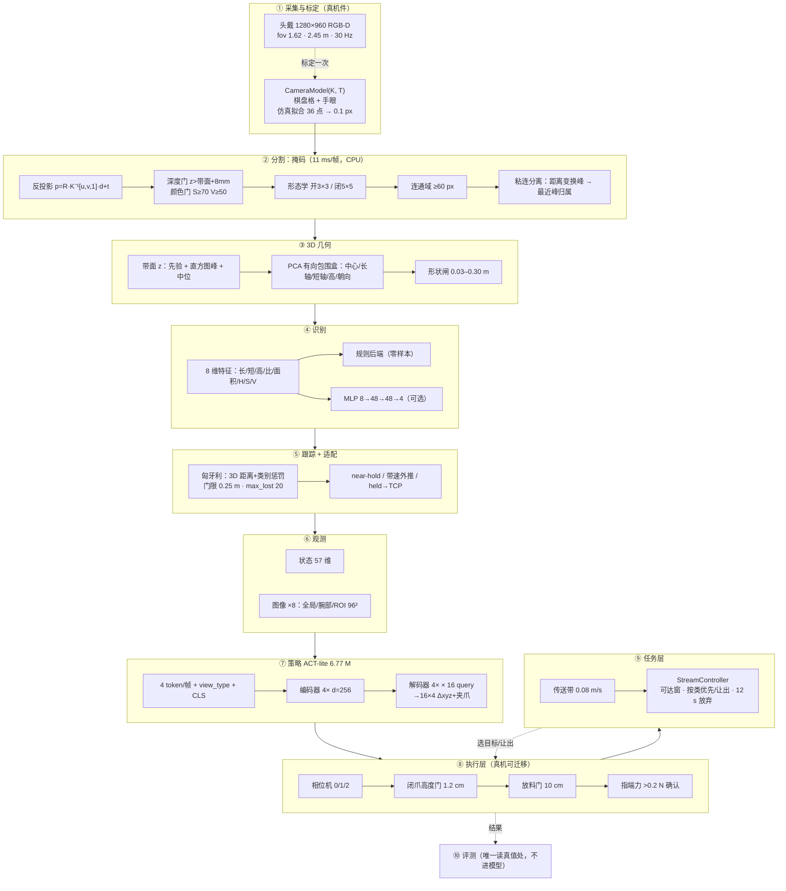

# v1.91 架构详解：感知 v2（分割 → 3D → 识别 → 跟踪）+ ACT-lite

> 图（详细，纵向）：`docs/architecture-v2.png` / `.svg`（源 `.dot`，`dot -Tpng -Gdpi=165`）
> 图（一页版，横屏 2×4）：`docs/architecture-v2-slide.png` / `.svg`（neato 显式坐标，比例 ≈2.2:1）
> 感知细节与实测数据见 [`perception-v2.md`](perception-v2.md)；本文是**整机视角**。

## 0. 一句话

相机 RGB-D → **反投影** → **深度/颜色双门分割** → **PCA 有向包围盒** → **8 维特征识别**
→ 匈牙利跟踪 → 57 维状态 + 3 路图像 → **ACT-lite（6.77 M）** 输出 16 步 Δxyz+夹爪
→ 执行层三道门（闭爪高度 / 放料 / 指端力确认）→ 产线。
**模型与策略侧读取仿真真值 0 次**（`FRUITSORT_AUDIT_GT=1` 实测）。

## 1. 全链路（Mermaid 版）



## 2. 每一层的输入输出（尺寸与单位）

| 层 | 输入 | 输出 | 关键参数 |
| --- | --- | --- | --- |
| 反投影 | `rgb (1280,960,3) uint8`、`depth (1280,960) m`、`K(3,3)`、`T(4,4)` | 世界点云 `(1280,960,3)` | 无效深度置 NaN；11 ms/帧 |
| 分割 | 点云 + rgb + 带面 z | `list[SegMask{mask,bbox,area,family,hue}]` | 高于带面 8 mm–35 cm；S≥70；面积≥60 px；峰阈值 0.8·max |
| 几何 | 掩码 + 点云 | `ObjGeometry{center(3), extent, width, height, yaw}` | 1/99 分位；高度=P95(z)−带面；形状闸 0.03–0.30 m |
| 识别 | 8 维特征 | `(kind, conf)` | 规则：红 45 mm / 黄 115 mm；MLP：8→48→48→4 |
| 跟踪 | 当帧实例 | 带 `track_id/vel` 的实例 | 代价=3D 距离+0.25·[类不同]；门限 0.25 m |
| 适配 | 每类实例 | 每类一个 `_Stub{p,v,raw_p,yaw,extent}` | near-hold 0.03–0.11 m；外推 ≤300 帧 |
| 观测 | 状态 + 3 路图 | `(57,) + (8,3,96,96)×3` | 见下 |
| 策略 | 上述 | `16×4` | d=256/8 头/4+4 层/ffn 3× |
| 执行 | 动作块 | 7 维 `[x,y,z,rx,ry,rz,grip]` | 按类限速 0.12/0.10/0.06 m/步 |

**状态 57 维**：TCP(7) + 关节角(9) + 带速(1) + 4 类×(p3,v3,active,held)=32 +
相位 one-hot(3) + 队列(1) + 抓取几何(4)。

## 3. 三道部署门（与模型无关，换机器人不用改）

| 门 | 判据 | 实测效果 |
| --- | --- | --- |
| 闭爪高度门 | `TCP.z − 果心 ∓ 1.2 cm` 内才允许闭爪，否则继续下探 | 闭爪落点 ±1.5 cm 命中 **0% → 85%** |
| 放料门 | 距本类框心 >10 cm 不许开爪，并把目标设为框心 | 掉落 **4/15 → 1/14** |
| 抓取确认 | 指端法向力 >0.2 N（真机=F/T） | 替代 `is_grasping`，模型侧真值读取归零 |

## 4. 真值边界

```
       ┌──────────── 模型/策略侧（真值 0 次）────────────┐
相机 → 分割 → 几何 → 识别 → 跟踪 → 观测 → ACT → 执行 → 机器人
       └───────────────────────────────────────────────┘
                                     │
                                结果（进框/掉落/漏过）
                                     ▼
                        评测/标注（真值只在这里出现）
```

审计命令：

```bash
FRUITSORT_AUDIT_GT=1 python scripts/stream_eval.py --perception rgbdv2 ...
# 模型/策略侧合计 : 0
# 环境(sim)侧合计 : 19094（物理/回收/记账，真机上由产线代替）
```

## 5. 复现

```bash
source scripts/env.sh maniskill3
python scripts/fit_camera_model.py                       # K,T → assets/calib/camera_overhead.json
python scripts/train_recognizer.py --frames 160          # 可选：识别头
python scripts/bench_perception.py                       # 感知对比（含倾斜机位）
python scripts/stream_eval.py --perception rgbdv2 --camera-calib overhead \
  --perception-targets --grasp-verify --decline-kinds strawberry,banana,pear \
  --close-z-gate-map apple=0.012 --close-z-off-map apple=0.0 --release-gate 0.10 \
  --belt 0.08 --slots 2 --seconds 90 --episodes 2 --seed 60002
```
