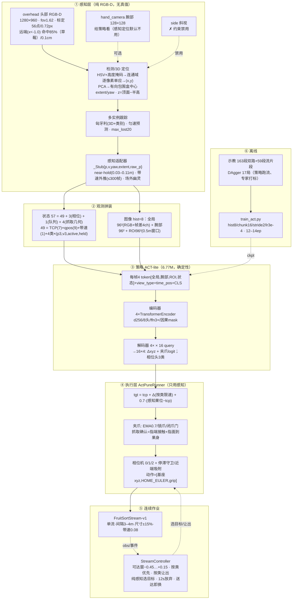
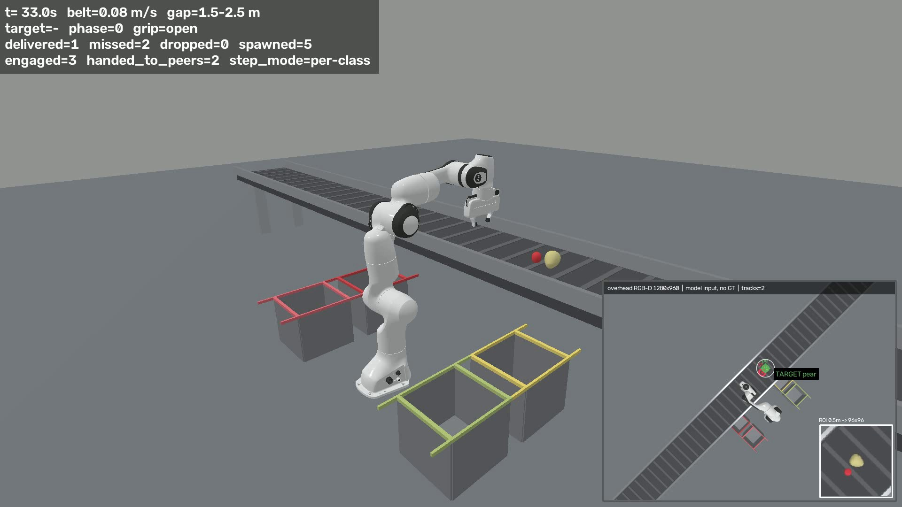

# FruitSort 端到端架构（v1.86）

> 图：`docs/architecture.png` / `docs/architecture.svg`（由 `docs/architecture.dot` 生成，`dot -Tpng -Gdpi=180`）
> 约束前提：**只用平行夹爪**、**头部 RGB-D（Gemini-335 量级）+ 腕部**、**不用斜视**、
> **模型输入不含仿真真值**（目标选择也走感知跟踪）。

## 1. 一张图（Mermaid 版，可直接改）



## 2. 关键参数

### 2.1 感知
| 项 | 值 |
| --- | --- |
| 头部相机 | 1280×960，fov 1.62 rad，h=2.45 m（`FRUITSORT_HEAD_FOV/RES/Z`） |
| 标定 | 56 点、重投影 0.72 px；`assets/calib/overhead_homography_gemini.npy`（`FRUITSORT_CALIB`） |
| 检测 | HSV 饱和>70 + “高于带面 8 mm”；连通域 → 逐像素单应 → PCA 有向包围盒（1/99 分位） |
| 定位精度 | 俯视：苹果 0.6 / 草莓 0.5 / 香蕉 0.5 / 梨 1.0 cm；远端(x<−1.0) 草莓 85%/0.1 cm |
| 跟踪 | 匈牙利（3D 距离 + 类别惩罚 0.25）、匀速预测、`max_lost=20` |
| 适配器 | `near-hold`（0.03–0.11 m 且丢检且贴爪 → 取 TCP）、丢检按带速外推 ≤300 帧、场外幽灵占位 |

### 2.2 观测与策略
| 项 | 值 |
| --- | --- |
| 状态 | 57 = 49（TCP7+qpos9+带速1+4×8）+ 相位 3 + 队列 1 + 几何 4 |
| 图像 | hist 8；全局 96²（RGB+帧差）；腕部 96²；ROI 96²（0.5 m 目标窗） |
| 模型 | ACT-lite：d256、8 头、enc/dec 4+4、ffn 3×、chunk 16、dropout 0.15、**6.77 M** |
| 输出 | 16×4：**Δxyz（相对 TCP）+ 夹爪 logit**；相位辅助头 3 类；CVAE 关闭 |
| 训练 | `hist8/chunk16/stride2/lr3e-4`；`--geom --phase --delta-actions --descend-boost 5`；12–14 epoch |
| 权重 | `runs/act-dagger/ckpt.pt`（部署）；`runs/act-dual2`（baseline，val 0.036） |

### 2.3 执行与调度
| 项 | 值 |
| --- | --- |
| 目标点 | `tgt = tcp + Δ`（按类限速 apple/草莓 0.12、梨 0.10、香蕉 0.06）+ `0.7·(果−tcp)`（仅 xy） |
| 夹爪 | logit EMA 0.7；搬运锁爪；闭爪门（果心−k×半高）；抓取确认=接触+指面到果身 |
| 相位 | 0 接近 / 1 下探 / 2 搬运（模型自预测 + 迟滞 + 停滞守卫） |
| 调度 | 可达窗 −0.45…+0.15；按类优先 apple>草莓>梨>香蕉；`--decline-kinds/--decline-yaw`；12 s 放弃 |

## 3. 复现命令

```bash
source scripts/env.sh maniskill3
export FRUITSORT_HEAD_FOV=1.62 FRUITSORT_HEAD_RES=1280x960 \
       FRUITSORT_CALIB=overhead_homography_gemini.npy

# A) 当前交付口径：只做苹果（其余按类让出）
python scripts/stream_eval.py --ckpt runs/act-dagger/ckpt.pt --perception rgbd \
  --perception-targets --grasp-verify --decline-yaw 0.64 \
  --kind-priority apple=0,strawberry=1,pear=2,banana=3 \
  --decline-kinds strawberry,banana,pear \
  --fb 0.7 --grip-ema 0.7 \
  --max-step-map apple=0.12,strawberry=0.12,pear=0.10,banana=0.06 \
  --carry-step-map apple=0.04,strawberry=0.04,pear=0.03,banana=0.02 \
  --belt 0.08 --seconds 60 --episodes 3 --slots 1 --gap-min 3.0 --gap-max 4.0 --seed 60001

# B) 全类都接（看完整链路，含失败）
python scripts/stream_eval.py --ckpt runs/act-dagger/ckpt.pt --perception rgbd \
  --perception-targets --grasp-verify --decline-yaw 0.64 \
  --kind-priority apple=0,strawberry=1,pear=2,banana=3 --fb 0.7 --grip-ema 0.7 \
  --max-step-map apple=0.12,strawberry=0.12,pear=0.10,banana=0.06 \
  --carry-step-map apple=0.04,strawberry=0.04,pear=0.03,banana=0.02 \
  --belt 0.08 --seconds 60 --episodes 3 --slots 1 --gap-min 3.0 --gap-max 4.0 --seed 60001
```

## 4. 结果（固定口径，5 seeds × 3 局 = 75 件）

| 类 | 送达/上料 | 95% CI | 说明 |
| --- | --- | --- | --- |
| **apple** | **11/26 = 42.3%** | 26–61% | 唯一稳定可用类；0 掉落 |
| strawberry | 0/16 | 0–19% | 稀疏口径 0；加密口径 1/9≈11%（累计≈4%） |
| banana | 0/16 | 0–19% | 长条机械；按类让出 |
| pear | 0/17 | 0–18% | 同上 |

**结构性结论**：刚性平口夹爪（闭合间距 ~3 cm）在仿真里夹不住 4 cm/18 g 的草莓；
草莓/香蕉/梨按类让给同伴，本臂定位为“只做能做的件”（`--decline-kinds`）。

## 5. 演示视频

| 文件（`data/fruitsort/eval/`） | 口径 | 结果 |
| --- | --- | --- |
| `head_rgbd_apple_only.mp4` | 交付口径，`--decline-kinds strawberry,banana,pear` | apple 1/1 |
| `head_rgbd_all_kinds.mp4` | 四类都接（看完整链路，含失败） | apple 1/1、strawberry 1/3、banana 0/1、pear 0/2 |

两段都用 `--perception rgbd --perception-targets --grasp-verify`，`gap 1.5–2.5 m`（为了 60 s 内
有足够事件而加密），无真值、无吸盘、无脚本搬运。视频内叠加了带速/时间/目标/相位/计数。

**画中画（`--video-inset`，默认开）**：右下角贴的就是**模型唯一的图像输入**——头部 1280×960
RGB-D，上面叠的是感知自己算出来的实例圈、TARGET 十字和 ROI 0.5 m 缩略图（→96×96）。
第三人称视角看不出"是否偷看真值"，画中画可以让人直接核对；`--no-video-inset` 可关掉。


