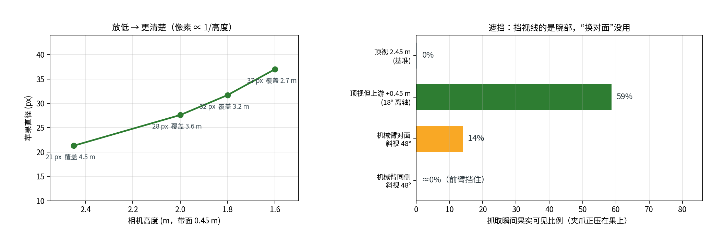

# 相机机位：放低 / 上游 / 对面，各换来什么

> 结论先行：**放低确实更清楚，但对"抓得住"没有帮助**（瓶颈不在分辨率）；
> **往上挪不买分辨率，只买预瞄**（现在已经有 17 s 预瞄，用不完）；
> **挪到机械臂对面在顶视下几乎无效**——因为挡视线的是"就在果实正上方"的腕部，
> 只有让视线对抓取点**离轴**才有效，而"往上/下游挪"恰好就是这种离轴。

测量脚本：`scripts/camera_bench.py`，原始数据 `runs/2026-11-26-camera-bench/sweep.json`。
所有机位都是 1280×960 / fov 1.62（Gemini 335 量级），单应矩阵按每个机位**重新标定**。



## 1. 一张表

| 机位 | px/m | 苹果 | 草莓 | 覆盖 x (m) | 预瞄 | 静态定位 | 抓取瞬间可见 |
| --- | --- | --- | --- | --- | --- | --- | --- |
| 基准 nadir 2.45 m | 328 | 21 px | 14 px | −2.28 … +2.24 | 26 s | 0.02 cm | **0.3%** |
| 放低 2.00 m | 425 | 28 px | 18 px | −1.84 … +1.78 | 20 s | 0.01 cm | 0.3% |
| 放低 1.80 m | 487 | 32 px | 21 px | −1.61 … +1.55 | 17.5 s | 0.3 cm | 0.2% |
| 放低 1.60 m | 569 | 37 px | 24 px | −1.36 … +1.34 | 15 s | 0.22 cm | 0.4% |
| 上游 +0.45 m @1.80 | 489 | 32 px | 21 px | −1.15 … +2.02 | 23 s | 0.03 cm | **59%** |
| 对面斜视 @1.75 m | 277 | 18 px | 12 px | −2.47 … +2.53 | 30 s | 0.3 cm | 14% |
| 机械臂同侧斜视 | 262 | 17 px | 11 px | −2.64 … +2.58 | 30 s | 0.86 cm | 0%（果实被整条手臂压住） |

"抓取瞬间可见" = 把机械臂停在苹果正上方、夹爪贴着果实时，果实还剩多少像素（相对无手臂时）。
"预瞄" = 视野上游端到可达窗上沿的距离 ÷ 带速 0.08 m/s。

## 2. 放低：能清楚多少，什么时候白放

像素密度 ∝ 1/相机到带面的高度，实测完全对得上（2.45→2.0 是 1.30×，测量 1.30×）：

| 高度 | px/m | 苹果直径 | ROI(0.5 m) 过采样 | 全局 96² 里苹果 |
| --- | --- | --- | --- | --- |
| 2.45 | 328 | 21 px | 1.7× | 1.6 px |
| 1.80 | 487 | 32 px | 2.5× | 2.4 px |
| 1.60 | 569 | 37 px | 3.0× | 2.8 px |

**收益到哪里为止**：策略真正吃的是 `ROI 0.5 m → 96×96`。2.45 m 时 0.5 m 已经是 164 px，
是 96 的 1.7 倍——**再过采样也没有新信息**，降到 1.6 m 只是把 1.7× 变成 3.0×，全被
`cv2.resize` 丢掉了。真正受益的是两处：

1. **检测器**（分割边界/主轴）：草莓 14→24 px，这是"小果检测"的量变；
2. **全局 96² 分支**：苹果 1.6→2.8 px，仍然是几个像素，量变不明显。

**下限由两个硬约束决定**，不是光学：

- **覆盖率**：需要 x ∈ [−0.80, +1.05]（可达窗 −0.45…+0.15，下游留 0.35 m 余量、上游留 0.9 m 预瞄）。
  1.60 m 时还剩 [−1.36, +1.34]，够；**1.45 m 就只剩 ±1.18**，下游余量开始不够。
- **机械净空**：手臂搬运高度到 1.2 m 上下，相机实体必须更高。所以 1.6–1.8 m 是可行下界。

**视差不是问题**（一个容易被忽略的细节）：`calibrate_camera.py` 是把果实**放到带面上**
标定的（`z = 带面 + half_height`），所以单应本身就是"果实中心高度"的单应，nadir 下
"果高造成的向外放大"已经被吸收；苹果(3 cm) 和香蕉(2 cm) 的果高差只带来 ≤2 mm 的残差。
实测静态定位 0.02–0.3 cm，与机位高度无关。

## 3. 上游：买的是预瞄，不是分辨率

nadir 平移**不改变任何像素尺度**（平面是平的，单应是均匀的）：2.45 m 下把相机挪到 +0.45 m，
px/m 从 487.2 → 489.0，噪声级差别。

它买到的只有"提前看到"：预瞄从 17.5 s 变成 23.3 s。而一次抓取从接管到放下 ≈ 4–6 s，
**17 s 已经用不完**——现有的外推（`hold_max=300` 帧）+ 队列计数已经够，再长的预瞄没有消费者。

代价是**下游余量**：覆盖从 [−1.61, +1.55] 变成 [−1.15, +2.02]，下游只剩 0.70 m。
如果以后要往下游放料框或加第二工位，这 0.9 m 就会被吃掉。

**但它顺带带来一个真收益**：相机中心离开抓取点 0.45 m 后，视线对抓取点有 **18° 离轴角**，
抓取瞬间果实可见比例从 **0.3% → 59%**（见下节）。这是"往上挪"唯一的实质性好处，
而且它其实属于"斜视"的收益，只是用平移免费拿到。

## 4. 对面：顶视下没用，斜视也要看斜哪边

几何上很干净：**挡视线的是"就在果实正上方"的腕部与夹爪**。对 nadir 相机，遮挡与机位在
带子的哪一侧**无关**（每个点都垂直投影）。实测：

| 机位 | 抓取瞬间可见 | 原因 |
| --- | --- | --- |
| nadir（任何高度、任何一侧） | 0.2–0.4% | 腕部+夹爪正好压在果实正上方 |
| 机械臂对面斜视 48° | 14% | 腕部仍在视线上，只是露了个边 |
| 机械臂同侧斜视 | 0% | 整条前臂挡在中间，静态就看不见 |
| 上游 +0.45 m（18° 离轴） | **59%** | 视线从侧前方掠过，腕部只遮一半 |

也就是说：**"对面"这个方向（沿 y）几乎没用**，因为手臂也是从 y<0 伸过来、爪子在果实正上方；
**"上下游"这个方向（沿 x）才有用**。要把遮挡彻底解决只有三条路，且都不是"换个机位"：

1. 接受抓取瞬间的遮挡（现状）：`near-hold` 在丢检且贴爪时直接用 TCP 位置，最后 3 cm 本就不需要视觉；
2. 腕部相机（已有，128×128，只当图像输入用）；
3. 掠射视角（相机压到接近带面高度）——会丢带面覆盖和分辨率，不建议。

顺带一个量级判断：手臂在带面上的投影阴影约 0.15 m × 0.15 m，占工作区（2 m × 0.4 m）**约 3%**；
而适配器丢检可以按带速外推 300 帧（15 s），远长于手臂扫过一次的时间——**手臂对"其他在飞件"的影响可以忽略**。

## 5. 闭环验证：清楚 ≠ 抓得住

固定口径（apple-only，gap 3–4 m、60 s、3 局/seed，成对同种子）：

| 机位 | seed 60001 | 60002 | 60003 | 合计 | 掉落 |
| --- | --- | --- | --- | --- | --- |
| nadir 2.45 m（基准） | 2/4 | 2/5 | 2/6 | **6/15 = 40%** | 0 |
| nadir 1.80 m（放低 27%） | 2/4 | 2/5 | 0/6 | 4/15 = 27% | 1 |
| 上游 +0.45 m @1.80 | 2/4 | 1/5 | 2/5 | 5/14 = 36% | 1 |

**三个机位在统计上分不开**：n≈15 时 40% 的 95% CI 是 17–65%，27% 和 36% 都落在里面。
能确定的是**没有提升**，而且两个改动各多摔了一件。

机制上也好解释：**分辨率不是这条链路的瓶颈**。苹果的失败模式是"接近段相位/时序冻结"
（见 `docs/model-architecture.md` 6.26），草莓是"爪口 3 cm 夹 4 cm 的果"，两者都不吃像素。
降机位只是把"检测到/没检测到"的边界情形挪了一下，反而让同种子下的时序分叉——所以第三个种子从 2/6 掉到 0/6。

> 口径提醒：这类小样本只能排除"大幅提升"，不能排除"±10% 的差异"。要判 5% 级别的差别，
> 至少 20 seeds × 3 局（≈100 次机会）。

## 6. 建议

1. **不要为了清晰度放低**；如果为了检测稳定性放低，**停在 1.8 m**（相对带面 1.35 m），
   别再往下——1.6 m 以下踩的是覆盖率和机械净空的线。
2. **不要为了规划往上游挪**：预瞄早已过剩，反而吃掉下游余量。
3. **不要指望换到对面去躲遮挡**：真正挡的是腕部；换机位只能换到 14%。
4. 如果只想改一件事：**保持 nadir、高度 1.8–2.0 m、中心对准可达窗（x≈0）**。
   在"抓取瞬间可见"上，唯一便宜且有效的改动是**相机沿带子方向偏 0.4–0.5 m**（离轴 18°）——
   **但它单独用没有收益**（实测 36% vs 40%，还多摔一件）：可见 59% 只有在
   "抓取确认改成看一眼"之后才有价值，否则只是多出来的像素没人消费。
5. 想真正提升，顺序是：**草莓的爪口/拦截时序** ≫ 机位 > 分辨率。
6. 如果一定要动相机，动**镜头**比动**位置**划算：Gemini 335 的 90° 视场对这个工位过剩
   （覆盖 4.5 m，实际只要 2 m），换成 60° 视场能在同样高度白拿 1.5× 像素，
   且不需要动机械结构和净空。

## 7. 复现

```bash
source scripts/env.sh maniskill3

# 机位扫描（含 px/m、覆盖率、精度、抓取瞬间可见）
python scripts/camera_bench.py                       # 全部 7 个机位，约 8 min
python scripts/camera_bench.py --poses lower         # 只跑放低

# 新机位需要重标定（单应与高度绑定）
FRUITSORT_HEAD_Z=1.80 FRUITSORT_CALIB=overhead_homography_gemini_z18.npy \
  python scripts/calibrate_camera.py

# 成对闭环
FRUITSORT_HEAD_Z=1.80 FRUITSORT_CALIB=overhead_homography_gemini_z18.npy \
  python scripts/stream_eval.py --ckpt runs/act-dagger/ckpt.pt --perception rgbd \
    --perception-targets --grasp-verify --decline-yaw 0.64 --decline-kinds strawberry,banana,pear \
    --kind-priority apple=0,strawberry=1,pear=2,banana=3 --belt 0.08 --seconds 60 \
    --episodes 3 --seed 60001
```

机位通过环境变量给：`FRUITSORT_HEAD_Z` 或 `FRUITSORT_HEAD_POS="x,y,z"` + `FRUITSORT_HEAD_LOOK="x,y"`。
