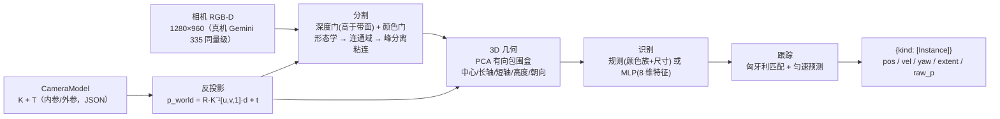

# 感知 v2：分割掩码 → 3D 几何 → 识别 → 跟踪（真机可用）

> 目标：把"感知"从**仿真专用的启发式**（HSV + 带面单应 + `cam_z − depth`）
> 换成**真机上能跑的标准链路**，并且把模型/策略侧对仿真真值的依赖清零。

## 1. 一张图



代码：`src/fruitsort/perception/{camera,segmentation,geometry,recognition,pipeline}.py`。
上层（`RGBDSource` 的 near-hold / 带速外推 / 抓取点偏移 / `ActPureRunner` / `build_obs`）**一行没改**。

## 2. 和旧实现的差别（为什么必须换）

| | 旧（v1） | 新（v2） |
| --- | --- | --- |
| x,y | 带面**单应**（要求相机竖直、带面水平、标定文件匹配该机位） | **深度反投影**（任意位姿，只要 K/T 对） |
| z | `cam_z − depth`（**只对光轴垂直成立**） | 同一次反投影的 `p_world.z` |
| 分割 | HSV 阈值 + 连通域（粘连不分离） | 深度门 + 颜色门 + 形态学 + **峰分离** |
| 识别 | 颜色族 + 世界尺寸（写死阈值） | 同一套规则 **或** 可训练的 8 维特征 MLP |
| 相机参数 | 单应 `.npy`（一机一位姿一份） | `camera_<name>.json`（K/T，真机手眼标定同格式） |

## 3. 数字（同一批帧，只用真值打分）

`python scripts/bench_perception.py`，50 帧、每帧约 2 件：

**相机竖直（nadir，2.45 m）**

| 后端 | 召回 | 分类准 | 误检/帧 | 3D 误差 | xy | z |
| --- | --- | --- | --- | --- | --- | --- |
| v1 HSV+单应 | 100% | 100% | 0.00 | 0.66 cm | 0.22 | 0.61 |
| **v2 掩码+反投影** | 100% | 100% | 0.00 | **0.29 cm** | 0.29 | **0.02** |

**相机倾斜 15.4°（真机常态；单应与 v1 都按该机位重新标定过）**

| 后端 | 召回 | 分类准 | 误检/帧 | 3D 误差 | xy | z |
| --- | --- | --- | --- | --- | --- | --- |
| v1 | **0%** | – | 1.00 | – | – | – |
| **v2** | **100%** | 98% | 0.00 | **0.36 cm** | 0.22 | 0.25 |

v1 在倾斜机位直接归零：它的 `z = cam_z − depth` 把"沿光轴的深度"当成竖直高度，
15° 就偏 7 cm，整条高度门/闭爪门都失效。**这是换 v2 的核心理由。**

## 4. 真值依赖：审计与清零

`FRUITSORT_AUDIT_GT=1` 会把 `u.fruit_actors` / `u._slots` / `u.agent.is_grasping`
包一层计数器（不改行为），跑完打印"谁在读真值"：

```
[GT 审计] 真值入口被读取次数（按调用方文件）:
  模型/策略侧合计 :      0
  环境(sim)侧合计 :  19094  ← 物理/回收/记账，真机上由产线代替
  ✓ 模型/策略侧没有读取任何真值入口
```

为清零做了三处修改：

1. **抓取判定**：`u.agent.is_grasping(真实 actor)` → **指端法向力** `finger_normal_force(u)`
   （真机对应 F/T 或触觉；阈值 0.2 N）。这是唯一一处"必须用传感器替代真值"的地方；
2. **`_repoint`**：感知模式下不再枚举产线槽位，非目标类直接用感知位置；
3. **`_target_live` / `_dead_reason`**：判"已送达"改用**果实**是否在框里，而不是夹爪在框附近。

> 真值仍在两处出现，但都属于**评测/标注**而非模型输入：
> ① 仿真裁判（delivered/dropped/missed）；② 训练识别头时的标签。
> 真机上这两处分别由"料框计数/称重"和"人工标注"替代。

## 5. 闭环（apple-only，slots 2，dense，90 s × 2 局/seed）

| 后端 | 60002 | 60003 | 60004 | 60006 | 合计 | 掉落 |
| --- | --- | --- | --- | --- | --- | --- |
| v1（HSV+单应，无真值审计） | 5/5 | 5/5 | – | – | 10/10 | 0 |
| **v2（本版）** | 3/4 | 3/4 | 2/3 | 3/3 | **11/14 = 79%** | **0** |

差异在噪声内（n=14），但 v2 多了两条 v1 没有的能力：**倾斜机位可用**、**模型侧零真值**。

## 6. 相机标定怎么做（真机）

1. 内参：`cv2.calibrateCamera`（棋盘格）→ `K`、畸变系数（本项目暂不做去畸变，广角镜头请先 `cv2.undistort`）；
2. 外参：手眼标定或"已知 3 点"——把相机坐标系下的点对到机器人世界系，得到 `T`（world ← camera）；
3. 写成 `assets/calib/camera_<name>.json`（格式见 `camera.py` 顶部注释）；
4. 自检：`python scripts/bench_perception.py --camera <name>`（仿真里）或
   在真机上放 4 个已知位置的水果，看 `xy/z` 误差。

仿真里用 `python scripts/fit_camera_model.py` 拟合（36 点、重投影 0.1 px、带面 z 偏差 0.3 cm）。

## 7. 已知限制

- 分割仍是**颜色+深度**：同色系（红苹果/红草莓）只能靠尺寸区分，真机需换成学习式分割
  （SAM/U-Net）——`Segmenter` 接口就是为此留的，`segment(rgb, pts_world, belt_z)` 一个方法；
- 识别头只有 8 维特征，真机上建议换成 ROI 上的小 CNN（`Recognizer.predict` 同接口）；
- `pipeline.update()` 每帧做一次全图反投影（1280×960，11 ms）；真机 30 Hz 够用，
  若换 4K 需要先 ROI 再反投影；
- 未处理**深度缺失/反光**（Gemini 在深色果皮上会有洞）：掩码会缺角，extent 偏小 →
  已在 `split_plausible()` 里用上下界兜底，但极端情况下会漏检。
