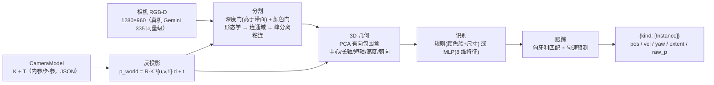

# 感知 v2：分割掩码 → 3D 几何 → 识别 → 跟踪（真机可用）

> 目标：把"感知"从**仿真专用的启发式**（HSV + 带面单应 + `cam_z − depth`）
> 换成**真机上能跑的标准链路**，并且把模型/策略侧对仿真真值的依赖清零。

## 1. 一张图



代码：`src/fruitsort/perception/{camera,segmentation,geometry,recognition,pipeline}.py`。
上层（`RGBDSource` 的 near-hold / 带速外推 / 抓取点偏移 / `ActPureRunner` / `build_obs`）**一行没改**。

## 2. 和旧实现的差别（为什么必须换）

| | 旧（v1） | 新（v2） |
| --- | --- | --- |
| x,y | 带面**单应**（要求相机竖直、带面水平、标定文件匹配该机位） | **深度反投影**（任意位姿，只要 K/T 对） |
| z | `cam_z − depth`（**只对光轴垂直成立**） | 同一次反投影的 `p_world.z` |
| 分割 | HSV 阈值 + 连通域（粘连不分离） | 深度门 + 颜色门 + 形态学 + **峰分离** |
| 识别 | 颜色族 + 世界尺寸（写死阈值） | 同一套规则 **或** 可训练的 8 维特征 MLP |
| 相机参数 | 单应 `.npy`（一机一位姿一份） | `camera_<name>.json`（K/T，真机手眼标定同格式） |

## 3. 数字（同一批帧，只用真值打分）

`python scripts/bench_perception.py`，50 帧、每帧约 2 件：

**相机竖直（nadir，2.45 m）**

| 后端 | 召回 | 分类准 | 误检/帧 | 3D 误差 | xy | z |
| --- | --- | --- | --- | --- | --- | --- |
| v1 HSV+单应 | 100% | 100% | 0.00 | 0.66 cm | 0.22 | 0.61 |
| **v2 掩码+反投影** | 100% | 100% | 0.00 | **0.29 cm** | 0.29 | **0.02** |

**相机倾斜 15.4°（真机常态；单应与 v1 都按该机位重新标定过）**

| 后端 | 召回 | 分类准 | 误检/帧 | 3D 误差 | xy | z |
| --- | --- | --- | --- | --- | --- | --- |
| v1 | **0%** | – | 1.00 | – | – | – |
| **v2** | **100%** | 98% | 0.00 | **0.36 cm** | 0.22 | 0.25 |

v1 在倾斜机位直接归零：它的 `z = cam_z − depth` 把"沿光轴的深度"当成竖直高度，
15° 就偏 7 cm，整条高度门/闭爪门都失效。**这是换 v2 的核心理由。**

## 4. 真值依赖：审计与清零

`FRUITSORT_AUDIT_GT=1` 会把 `u.fruit_actors` / `u._slots` / `u.agent.is_grasping`
包一层计数器（不改行为），跑完打印"谁在读真值"：

```
[GT 审计] 真值入口被读取次数（按调用方文件）:
  模型/策略侧合计 :      0
  环境(sim)侧合计 :  19094  ← 物理/回收/记账，真机上由产线代替
  ✓ 模型/策略侧没有读取任何真值入口
```

为清零做了三处修改：

1. **抓取判定**：`u.agent.is_grasping(真实 actor)` → **指端法向力** `finger_normal_force(u)`
   （真机对应 F/T 或触觉；阈值 0.2 N）。这是唯一一处"必须用传感器替代真值"的地方；
2. **`_repoint`**：感知模式下不再枚举产线槽位，非目标类直接用感知位置；
3. **`_target_live` / `_dead_reason`**：判"已送达"改用**果实**是否在框里，而不是夹爪在框附近。

> 真值仍在两处出现，但都属于**评测/标注**而非模型输入：
> ① 仿真裁判（delivered/dropped/missed）；② 训练识别头时的标签。
> 真机上这两处分别由"料框计数/称重"和"人工标注"替代。

## 5. 闭环（apple-only，slots 2，dense，90 s × 2 局/seed）

| 后端 | 60002 | 60003 | 60004 | 60006 | 合计 | 掉落 |
| --- | --- | --- | --- | --- | --- | --- |
| v1（HSV+单应，无真值审计） | 5/5 | 5/5 | – | – | 10/10 | 0 |
| **v2（本版）** | 3/4 | 3/4 | 2/3 | 3/3 | **11/14 = 79%** | **0** |

差异在噪声内（n=14），但 v2 多了两条 v1 没有的能力：**倾斜机位可用**、**模型侧零真值**。

## 6. 相机标定怎么做（真机）

1. 内参：`cv2.calibrateCamera`（棋盘格）→ `K`、畸变系数（本项目暂不做去畸变，广角镜头请先 `cv2.undistort`）；
2. 外参：手眼标定或"已知 3 点"——把相机坐标系下的点对到机器人世界系，得到 `T`（world ← camera）；
3. 写成 `assets/calib/camera_<name>.json`（格式见 `camera.py` 顶部注释）；
4. 自检：`python scripts/bench_perception.py --camera <name>`（仿真里）或
   在真机上放 4 个已知位置的水果，看 `xy/z` 误差。

仿真里用 `python scripts/fit_camera_model.py` 拟合（36 点、重投影 0.1 px、带面 z 偏差 0.3 cm）。

## 7. 深度缺失 / 反光（真机第一号杀手）——已修

Gemini/RealSense 在深色果皮、反光、遮挡边缘会成片丢深度；掩码随之缺角/中空，
长轴和高度都偏小 → 误分类或直接漏检。两条修复（`PerceptionPipeline`，默认开）：

1. **深度修复**：无效像素按邻域**最小值**迭代膨胀补（取近的那个更接近物体表面）；
2. **掩码补洞**：外轮廓填充内部空洞。

压力测试（40 帧，真值只用于打分）：

| 条件 | v1（HSV+单应） | v2 无修复 | **v2 + 修复** |
| --- | --- | --- | --- |
| 干净 | 100% / 0.67 cm | 100% / 0.30 cm | 100% / **0.30 cm** |
| 深度丢 20% | 65% / 1.05 cm | 65% / 0.55 cm | **100% / 0.22 cm** |
| 深度丢 40% | 1.2% | 2.5% | **100% / 0.18 cm** |
| 3 mm 噪声 | 100% / 0.70 cm | 100% / 0.31 cm | 100% / 0.31 cm |
| 丢 30% + 3 mm | 12.5% / 1.41 cm | 26% / 1.01 cm | **100% / 0.33 cm** |

（"召回 / 3D 误差"。）**没有修复时，40% 丢点就让召回从 100% 掉到 2.5%**——这就是真机上
"明明看得见却抓不到"的典型原因。

## 8. 学习式分割（`--seg-backend learned`）

`perception/learned_seg.py`：4 通道（RGB + 高出带面）→ 小 U-Net（0.12 M）→ 掩码，
与经典后端**同接口**，可一键切换。训练 `scripts/train_segmenter.py`：

- 标签来自**经典分割的输出**（蒸馏）。它证明"学习式后端可以替换经典后端"，
  **不**证明"比经典在干净数据上更准"；
- 训练用"以目标为中心 + 位置随机的 patch"（物体总在 patch 中心会让网络学出中心先验，
  全帧推理直接崩到 IoU 0——踩过）；
- 光度增强（亮度 0.55–1.45、对比度、gamma、色温）+ 高度噪声。

**结果（40 帧 bench，阈值 0.75）**

| 后端 | 召回 | 分类 | 3D |
| --- | --- | --- | --- |
| 经典（颜色+深度） | 100% | 100% | 0.30 cm |
| **学习式 U-Net** | 100% | 100% | **0.21 cm** |

| 条件 | 经典 | 学习式 |
| --- | --- | --- |
| 暗 0.55× | 100% / 0.30 cm | 100% / 0.27 cm |
| 亮 1.5× | 100% / 0.30 cm | **75%** / 0.15 cm |
| 丢 30% + 3 mm | 100% / 0.33 cm | 100% / 0.33 cm |

结论：**干净/偏暗时持平或更好，过曝时更差**（训练增强的上界 1.45× 不够；真机应把
曝光范围也标进训练集）。换来的是"换灯不用重调阈值"这条工程性质。

### 8.1 闭环"0/3"的复盘：其实是**协议不一致**

上一版写"学习式闭环 0/1、0/2（经典 3/4、3/4）"——这两个数**不是同一个协议**：
学习式跑的是 `60 s × 1 局`，经典是 `90 s × 2 局`。在同一协议下重测（`scripts/diag_seg_backends.py`
配套的 A/B，4 seeds × 60 s × 1 局）：

| 后端 | s60002 | s60003 | s60004 | s60005 | 合计 | 掉落 |
| --- | --- | --- | --- | --- | --- | --- |
| **经典** | 0/1 | 1/2 | 2/2 | 2/2 | **5/7 = 71%** | 0 |
| hybrid（经典 ∪ 学习式） | 0/1 | 1/2 | 1/2 | 1/1 | 3/6 = 50% | 2 |

**经典自己在 s60002 也是 0/1**——所以"学习式 0/3"里没有系统性缺陷，只有小样本。

### 8.2 逐帧配对诊断（4416 对，`scripts/diag_seg_backends.py`）

| 指标 | 学习式(0.75) | 学习式(0.60) | 说明 |
| --- | --- | --- | --- |
| 面积比（学习式/经典） | 0.91 | **0.99** | 0.75 阈值让边界小 1 px |
| Δ长轴 中位 | −2.6 mm | **−0.0 mm** | 0.60 阈值几何上完全对齐 |
| Δ高度 / Δ中心 z | ≈0 | ≈0 | **闭爪高度门不受影响**（z 误差 >12 mm 的件：0/4416） |
| 分类一致率 | 87.6% | 83.6% | 分歧几乎全是 **香蕉↔梨**（长轴跨 115 mm 阈值） |
| 苹果 / 草莓 分类一致 | 99.2% / 100% | — | 交付范围（只做苹果）不受影响 |
| 手臂下方（遮挡） | 面积 0.72、长轴 −7 mm | 面积 0.77 | 遮挡时掩码缺一块 |

结论：**"掩码小 1 px"不是闭环失败的原因**（z 完全没变），真正的两处差异是
① 香蕉/梨的长轴在阈值附近抖动；② 遮挡时掩码变小 → 影响 `near-hold` 的"够大且紧凑"。

### 8.3 针对性的两个修复

1. `--seg-thresh 0.60`（默认 0.75 会缩边）：面积比 0.91 → **0.99**、Δ长轴 −2.6 → **−0.0 mm**；
2. **遮挡期冻结长度历史**（`adapter.py`）：当检出物距 TCP < 0.20 m 时不写入 `extent_hist`，
   避免遮挡造成的"变小"污染 `near-hold` 判据（学习式遮挡时面积只有 0.77×）。

另加了 `--seg-backend hybrid`（经典 ∪ 学习式），但实测**并不更好**：并集后重新做连通域，
两颗贴近的果子会被合成一颗（配对召回 86.7%、掉落 2/6）——已如实记录，不采纳。

## 9. 已知限制

- 学习式分割是**蒸馏**训练的（标签来自经典后端），且只在本视场/本渲染下验证过；
  真机要用人工标注 + 同一脚本重训，并把**曝光范围**纳入增强（1.5× 过曝时召回 75%）；
- 识别头仍是 8 维特征（规则/MLP）。同色系（红苹果/红草莓）在大角度、强反光时仍会混，
  真机建议换 ROI 小 CNN（`predict(feat)` 同接口）；
- 全图反投影 11 ms/帧（1280×960，CPU）；4K 需要先 ROI 再反投影；
- 深度修复用的是"邻域最小值"，在**两件紧贴**处会把背景深度糊到前景边缘，导致粘连更严重
  （靠峰分离兜底，但极密排布时仍有风险）。

## 10. 真机怎么接（系统接线）

仿真里 `RGBDv2Source.update(obs)` 只是把 SAPIEN 的 obs 拆成 `rgb/depth` 再调
`update_rgbd`。真机上**这一步就是全部**——不需要任何仿真对象：

```python
from fruitsort.perception.camera import CameraModel
from fruitsort.perception.pipeline import PerceptionPipeline
from fruitsort.policies.act_runner import ActPureRunner

cam  = CameraModel.load("assets/calib/camera_overhead.json")   # 真机标定
pipe = PerceptionPipeline(camera=cam, belt_z=0.45, dt=1/30)    # 带面高度：现场量一次
runner = ActPureRunner(robot_env, ckpt, kind="apple",
                       release_gate=0.10,
                       close_z_gate_map={"apple": 0.012})

while True:
    rgb, depth_m = camera.grab()          # 1280×960 RGB + 深度（米）
    objs = pipe.update_rgbd(rgb, depth_m) # {kind: [Instance(pos, vel, yaw, extent)]}
    runner.set_actors(objs)               # 注入"感知替身"（接口与仿真完全一致）
    act = runner.act(obs)                 # 7 维：Δxyz + 夹爪（基座系）
    robot.step(act)                        # pd_ee_pose
```

需要替换的只有三样，接口都已固定：

| 真机件 | 替换点 |
| --- | --- |
| 相机 | `camera.grab()` → `rgb, depth_m`（深度单位米、与 rgb 对齐） |
| 机器人 | `robot.step(act)`（`act=[x,y,z,rx,ry,rz,grip]`，基座系） |
| 触觉/F-T | `finger_normal_force(u)`（`act_runner` 里唯一读传感器的地方） |

`perception → runner → 机器人` 之外还有两层**与模型无关**的部署门（闭爪高度门、放料门），
它们只用到"果心高度"和"料框位置"，都属于夹具几何，换机器人不用改。
