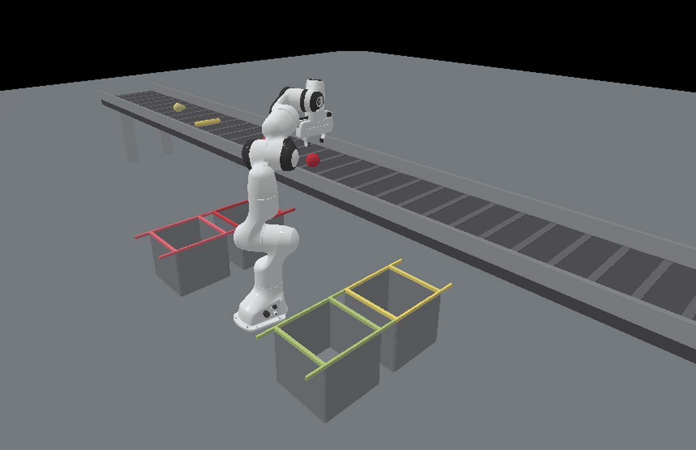
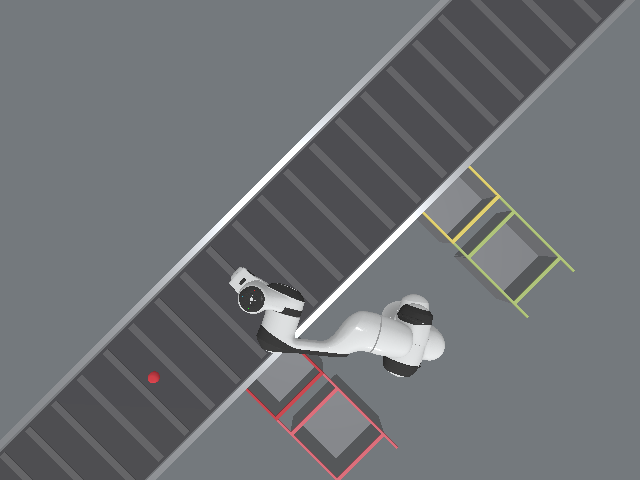
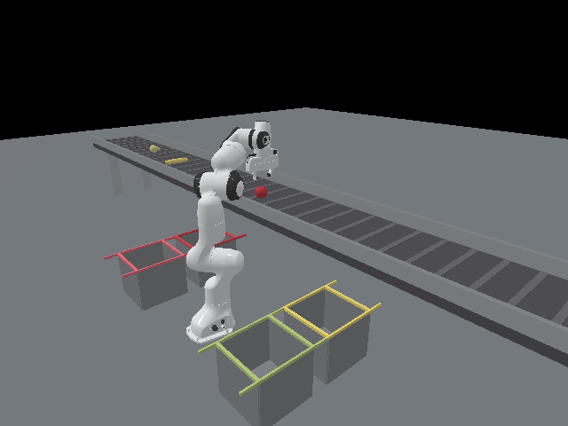

# 仿真资产规格

> 所有网格由 `src/fruitsort/sim/assets/fruit_meshes.py` 程序化生成（trimesh → GLB，凸包碰撞），
> 可复现、无外部下载。尺寸/质量参考真实水果；摩擦系数为**抓取稳定性做过上调**的仿真值。

## 水果

| 类别 | 尺寸 (mm) | 质量 (g) | 颜色 (RGB) | 粗糙度 | 静/动摩擦 | 恢复系数 | 形状要点 |
| --- | --- | --- | --- | --- | --- | --- | --- |
| 苹果 | 66 × 66 × 58 | 150 | (0.62, 0.04, 0.06) 深红 | 0.32 | 0.70 / 0.60 | 0.03 | 扁球 + 顶部凹陷 + 小平面底 |
| 草莓 | 37 × 37 × 42 | 18 | (0.80, 0.06, 0.08) 鲜红 | 0.45 | 0.60 / 0.50 | 0.03 | 圆锥体 + 圆肩 + 平底 |
| 香蕉 | 170 × 43 × 32 | 110 | (0.92, 0.76, 0.22) 黄 | 0.55 | 1.00 / 0.90 | 0.03 | 圆弧扫掠管，两端收细 |
| 梨 | 60 × 60 × 82 | 160 | (0.78, 0.72, 0.32) 黄绿 | 0.40 | 1.10 / 1.00 | 0.03 | 回转体，下宽上窄 |

- 视觉：PBR `base_color` + `roughness`；未使用贴图（避免外部资产依赖）。
- 碰撞：`add_convex_collision_from_file`（凸包）。香蕉/梨为近似凸体，抓取仿真够用。
- 密度：由 `质量 / 凸包体积` 反推，保证 SAPIEN 自动算质量正确。

## 机器人

| 项 | 值 |
| --- | --- |
| 型号 | Franka Panda（ManiSkill3 原生 `panda` 资产，7-DoF + 平行夹爪） |
| 基座位姿 | `(0, -0.50, 0)`，绕 z +90° |
| TCP | `panda_hand_tcp`，home 位姿约 `(-0.02, -0.33, 0.67)` |
| 控制模式 | `pd_ee_pose`（绝对位姿，20 Hz），夹爪二值 |
| 初始关节 | `[0, -0.9, 0, -1.9, 0, 1.0, 0.8, 0.04, 0.04]`（抬起的 home，避免从带下出发） |

## 传送带与料框

| 项 | 值 |
| --- | --- |
| 带体 | 5.0 m × 0.40 m × 0.05 m，带面高 0.45 m |
| 侧导轨 | 高 0.06 m，宽 0.02 m（限制水果横向漂移） |
| 驱动 | 低摩擦带面（μ≈0.04）+ 每物理子步速度伺服；有效速度 ≈ 0.83× 名义带速 |
| 条纹 | 每 0.12 m 一条深色视觉条带（纯视觉） |
| 料框 | 4 个，0.24 × 0.24 × 0.22 m，壁厚 8 mm，彩色边沿区分类别 |
| 料框位置 | 苹果 (−0.46, −0.28)、草莓 (−0.46, −0.60)、香蕉 (0.46, −0.28)、梨 (0.46, −0.60) |

## 场景图

| 视角 | 图 |
| --- | --- |
| 全景（人眼相机，机器人 + 传送带 + 四个料框） |  |
| 俯视感知相机（overhead，注意画面相对世界旋转约 45°，单应矩阵已补偿） |  |
| 侧视相机（side） |  |

## 相机

| 名称 | 位置（look_at） | 分辨率 | FOV |
| --- | --- | --- | --- |
| `overhead` | (0, −0.08, 1.35) → (0, −0.08, 0.45) | 640×480 | 56° |
| `side` | (1.35, −1.30, 1.15) → (0, −0.10, 0.45) | 640×480 | 56° |
| `render_camera` | (1.45, −1.50, 1.25) → (0, −0.15, 0.45) | 1280×720 | 60° |

## 重建资产

```bash
source scripts/env.sh maniskill3
python -m fruitsort.sim.assets.fruit_meshes   # 覆盖生成 assets/meshes/*.glb
```

> 注意：修改网格后需 `build_all(force=True)`，否则会沿用旧的 GLB。
